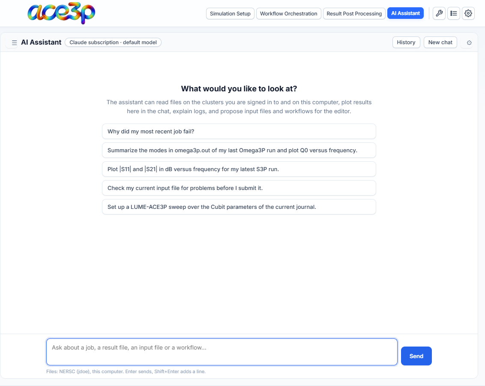
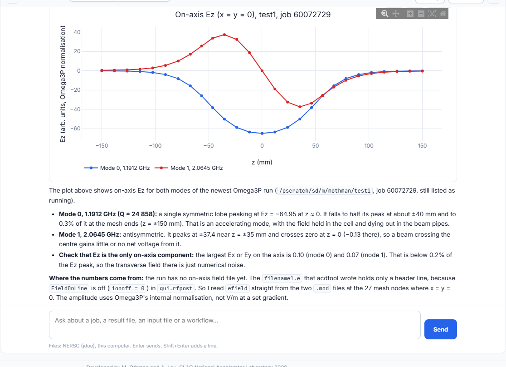
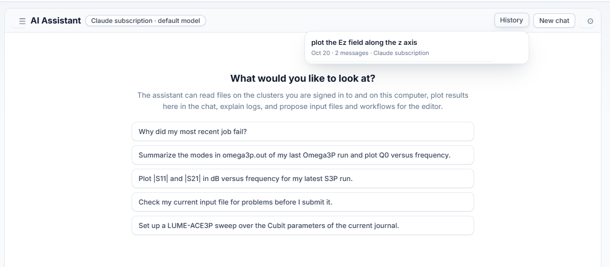

# Use the AI Assistant

The **AI Assistant** is an agent with access to the app, your jobs and your
files. It reads files on the clusters you are signed in to and on your
computer, sets up meshes, input files and LUME-ACE3P workflows in the app's own
views, runs simulations, follows the jobs and plots the results in the chat.
With **Agentic mode** on it carries a whole task through without asking for
approval at each step.

Before the first use, set up a model provider: see
[Set up a model provider](providers.md).

## Layout

- **Left column — files:** pick **NERSC**, **S3DF** or **This computer**, then
  browse. **↑** goes up one level, **↻** refreshes. Click a file to view it;
  press **+** next to a file (or **Add to chat** in the viewer) to attach it to
  your next message. **☰** in the chat header hides or shows this column.
- **Chat header:** the provider and model in use (click it to change them),
  the title of the chat, **History**, **New chat** and **⚙** settings.
- **Message box:** ++enter++ sends, ++shift+enter++ starts a new line. While
  the assistant works, **Send** becomes **Stop**.

## What to ask

The start page offers examples:

- *Why did my most recent job fail?*
- *Summarize the modes in omega3p.out of my last Omega3P run and plot Q0 versus
  frequency.*
- *Plot |S11| and |S21| in dB versus frequency for my latest S3P run.*
- *Check my current input file for problems before I submit it.*
- *Set up a LUME-ACE3P sweep over the Cubit parameters of the current journal.*

The assistant sees what is on screen in the app: the editor's input file, the
sbatch script, the workflow YAML and its checks, the mesh name and your recent
jobs with their run directories. You do not need to paste them.

Be specific about the job (its name or run directory) and the quantity. Name
files when you know them.

## Example

Asked to plot Ez along the z axis, the assistant found the latest Omega3P run,
read the field values from its `.mod` files, plotted both modes in the chat,
and explained the result and how to improve it with acdtool.

Each tool the assistant uses appears in the chat as a collapsible step with its
input and result. The line under an answer shows the tokens used and, for
paid providers, the cost.

## What the assistant can do

| Action | Needs your approval |
|---|---|
| Read the app's state (input file, sbatch, workflow, mesh, jobs) | No |
| List folders, read files, search file names and contents | No |
| Read result tables (`omega3p.out`, S-parameters, LUME tables, column files) | No |
| Plot data in the chat | No |
| Inspect the header of a NetCDF file (`.ncdf`, `.mod`) | No |
| Select a mesh, set Cubit journal variables and remesh | No |
| Check a mesh: element quality, elements per wavelength, sidesets, boundary conditions | No |
| Load or edit the input file in the editor | No |
| Build or edit a LUME-ACE3P workflow (sweep, optimization) and its files | No |
| Change Simulation Settings (cluster or this PC, processes, queue, walltime) | No |
| Follow a job: state, log tails, result files | No |
| Write or edit a file | **Yes** (setting) |
| Run a shell command (maximum 300 s) | **Yes** (setting) |
| Run a simulation or a workflow study | **Yes** (setting) |

In Agentic mode none of these asks.

### Approvals

When the assistant wants to write a file, run a command or start a
simulation, an approval card shows the diff, the command or the run. Press
**Approve** or **Decline**. An edited file keeps its previous version as
`<file>.agent-bak`.

Turn approvals off in **⚙ → Permissions**, or use Agentic mode, only if you
accept that the assistant changes files, runs commands and submits jobs
without asking.

!!! warning
    Commands run through the same cluster session as the rest of the app and
    are limited to 300 seconds. Solver runs are submitted as jobs through
    **Run Simulation**, never run through that session.

## Agentic mode

### What "agentic" means here

The assistant is three parts:

- **Model.** A large language model (Claude, or a model behind an
  OpenAI-compatible server). It only produces text. Besides plain answers it
  can produce *tool calls*: a tool name with JSON arguments, such as
  `edit_journal {"variables": {"radius": 92.1}}`.
- **Tools.** 28 functions the app defines, each with a JSON schema the
  model is given. They read files and result tables, plot, select and remesh
  a mesh, edit the input file, build a LUME-ACE3P workflow, change Simulation
  Settings, run a shell command, submit a simulation (`run_simulation`) and
  follow a job (`job_status`). App tools act on the GUI itself, through the
  same functions the buttons call, so every change shows up in the views.
- **Harness.** The program around the model that turns its text into actions.
  In this app it is the backend's agent loop (`backend/aiagent`). For each
  message it:
    1. builds the *context*: a system prompt (the assistant's role and working
       rules, an index of guides and skills, your instructions, the signed-in
       clusters, the module on screen) plus the conversation so far;
    2. sends the context and the tool schemas to the model;
    3. runs each tool call the model returns, after an approval check if
       the tool writes, runs a command or submits a job;
    4. appends the results to the conversation and goes back to step 2.

    The loop ends when the model answers without a tool call, when you press
    **Stop**, or when the step limit is reached. One pass through steps 2–4 is
    a *step*. The harness also enforces the limits that do not depend on the
    model: the 300 s command timeout, file size caps, and the rule that solver
    runs go through Run Simulation as jobs. With the **Claude subscription**
    provider the loop is run by Claude Code (`claude -p`) instead. Its own file
    and shell tools are switched off, and it reaches the same app tools through
    an MCP server the backend provides, with the same approval checks.

The model decides which tool to call next; the harness decides whether and
how the call is carried out. Without Agentic mode the harness stops at each
gated call for an approval card, and the step limit is 40, so a long task
comes back to you several times.

**Agentic mode changes only the harness settings, not the model or the
tools:**

| | Normal | Agentic |
|---|---|---|
| Approval check for writes, commands and submissions | Approval card, or the **⚙ → Permissions** setting | Granted automatically |
| Step limit per message | 40 (`max_steps`) | 200 (`agentic_max_steps`) |
| System prompt | Base rules: propose, ask before submitting | Base rules plus an agentic section: do not ask, state assumptions, run the simulation, read results, iterate |

The model has no access beyond the tools. It cannot reach a cluster you are
not signed in to, start a solver outside a job, or run a command longer than
300 s, in either mode.

### Using it

Press **Agentic** in the assistant's bar and confirm once. The button reads
**Agentic: on** until you click it again; the choice is kept in this browser.
While it is on:

- No approval cards. Each edit, command and run is still listed in the chat as
  a step you can expand.
- The assistant does not stop to ask for details. It picks values from the
  physics, states them as assumptions and continues.
- **Run simulations.** It meshes the Cubit journal, checks the mesh and its
  sidesets, writes the input file and boundary conditions, and presses **Run
  Simulation** for the target chosen in Simulation Settings: NERSC Perlmutter,
  S3DF or Local (this PC). Each run gets its own folder,
  `agent-<name>-<date>-<time>`, under the target's base directory.
- **Parametrization.** It sets Cubit journal variables and solver parameters
  directly, or builds a LUME-ACE3P parameter sweep or optimization in Workflow
  Orchestration and submits the study.
- **Closed loop.** It follows the job to the end, reads the results
  (`omega3p.out`, S-parameters, LUME tables), plots them, compares them with
  the goal and changes the design. It stops when the goal is met, when another
  iteration would not change the conclusion, or after about five iterations.
- **Failures.** It reads the error log, fixes the cause and resubmits; after
  three failures of the same kind it stops and reports.
- A task may take up to 200 model steps (setting `agentic_max_steps`) instead
  of 40.
- **Stop** ends the run at any time, also while it waits for a job.

It finishes with the design and its parameters, the numbers that show the goal
is met, the assumptions it made and the run folder.

Example: *Design a pillbox cavity with its TM010 mode at 1.3 GHz.* On the Local
target the assistant meshed a CW23 pillbox journal, ran Omega3P three times
with radii of 88.3, 92.33 and 92.10 mm, and stopped at 1.29978 GHz with
Q0 = 25,134, with no approvals asked.

On the Local target keep the number of processes at or below the physical core
count and the problem within the memory the target reports; the assistant
follows the same rule.

### Proposals

A proposed input file or workflow appears as a card with:

- **Apply to editor** — loads the input file into the solver's form
  (Simulation Setup), or **Open in workflow builder** for a YAML,
- **Copy**, **Download**, **Show all**.

Review the result in the editor before you submit.

### Plots

Plots in the chat are interactive (zoom, pan, hover). Each has **PNG**, **CSV**
and **Expand** buttons.

## Chat history

Every chat is saved on your computer when an answer finishes.

- **History** lists saved chats, newest first. Click one to open it; **✎**
  renames, **✕** deletes.
- **New chat** starts an empty chat. The previous one stays in History.
- The last open chat reopens when you come back to the tab, also after a
  restart of the app. A reopened chat continues with its full history.

A chat belongs to one provider. If you switch providers, an old chat keeps its
transcript but the model starts the conversation fresh.

## Your instructions, skills and guides

All three are text the assistant reads; there is no training step.

**Your instructions** (**⚙ → Your instructions**) are added to every chat:
units you prefer, how to name plots, project paths, how to report. They are
saved in `instructions.md` in the app's AI folder.

**Skills** (**⚙ → Skills**) are your own procedures in Claude's skill format:
a folder with a `SKILL.md` (front matter `name` and `description`, then the
instructions) and any files beside it, such as templates, reference tables or
scripts. A skill written for Claude Code or claude.ai works unchanged. The
assistant sees each enabled skill's name and description and opens a skill
when a task matches it.

- **Upload .md / .zip** adds a `SKILL.md`, any Markdown file, or a `.zip` /
  `.skill` archive of a skill folder.
- **Add from link** adds a skill from a GitHub folder or file, or a raw `.md`
  or archive URL.
- **Write a skill** opens a template in an editor.
- Each skill can be switched off, edited or deleted.
- **Also use my Claude Code skills** offers the skills in `~/.claude/skills`
  as well, read only.

A script bundled with a skill runs only as a shell command, which asks first
unless Agentic mode is on.

**Reference guides** are Markdown files the assistant reads when a task needs
them. The app ships guides on ACE3P result files, job debugging, LUME-ACE3P,
input files and design studies. Add your own as `.md` files in the folder shown in the settings.
Start each file with a line `description: ...` that says when to use it. A
guide with the same name as a shipped one replaces it.
