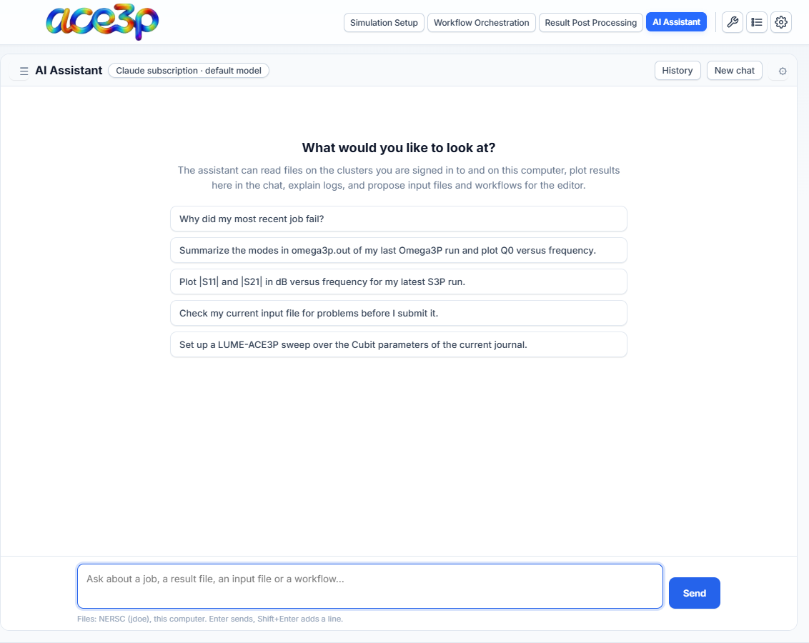
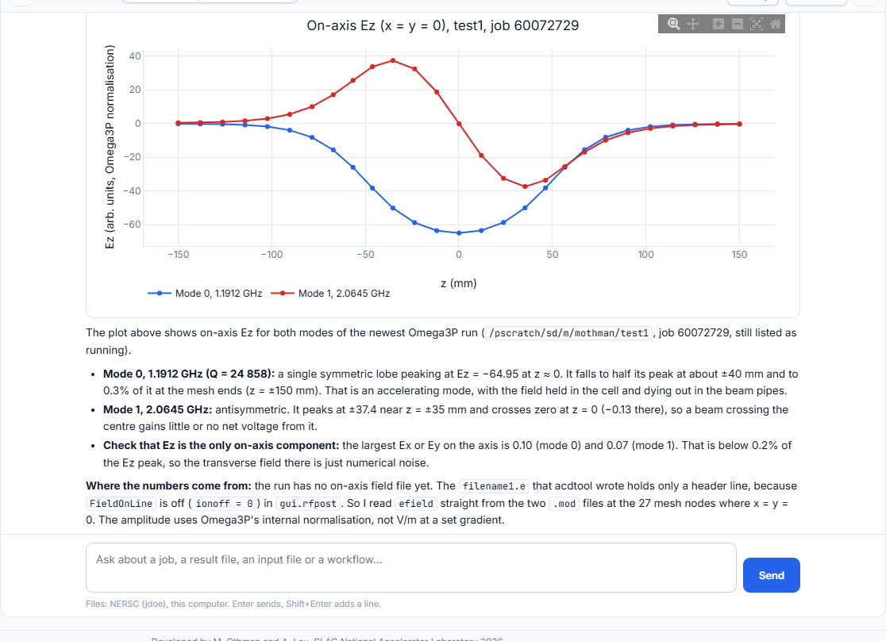
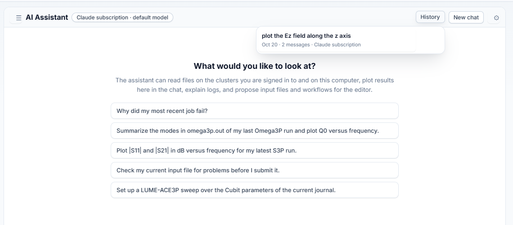

# Use the AI Assistant

The **AI Assistant** is a chat assistant with access to your jobs and files. It
reads files on the clusters you are signed in to and on your computer, plots
results in the chat, explains logs and errors, and proposes input files and
LUME-ACE3P workflows that you can load into the editor with one click.

Before the first use, set up a model provider: see
[Set up a model provider](providers.md).

## Layout

- **Left column — files:** pick **NERSC**, **S3DF** or **This computer**, then
  browse. **↑** goes up one level, **↻** refreshes. Click a file to view it;
  press **+** next to a file (or **Add to chat** in the viewer) to attach it to
  your next message. **☰** in the chat header hides or shows this column.
- **Chat header:** the provider and model in use (click it to change them),
  the title of the chat, **History**, **New chat** and **⚙** settings.
- **Message box:** ++enter++ sends, ++shift+enter++ starts a new line. While
  the assistant works, **Send** becomes **Stop**.

## What to ask

The start page offers examples:

- *Why did my most recent job fail?*
- *Summarize the modes in omega3p.out of my last Omega3P run and plot Q0 versus
  frequency.*
- *Plot |S11| and |S21| in dB versus frequency for my latest S3P run.*
- *Check my current input file for problems before I submit it.*
- *Set up a LUME-ACE3P sweep over the Cubit parameters of the current journal.*

The assistant sees what is on screen in the app: the editor's input file, the
sbatch script, the workflow YAML and its checks, the mesh name and your recent
jobs with their run directories. You do not need to paste them.

Be specific about the job (its name or run directory) and the quantity. Name
files when you know them.

## Example

Asked to plot Ez along the z axis, the assistant found the latest Omega3P run,
read the field values from its `.mod` files, plotted both modes in the chat,
and explained the result and how to improve it with acdtool.

Each tool the assistant uses appears in the chat as a collapsible step with its
input and result. The line under an answer shows the tokens used and, for
paid providers, the cost.

## What the assistant can do

| Action | Needs your approval |
|---|---|
| Read the app's state (input file, sbatch, workflow, jobs) | No |
| List folders, read files, search file names and contents | No |
| Read result tables (`omega3p.out`, S-parameters, LUME tables, column files) | No |
| Plot data in the chat | No |
| Inspect the header of a NetCDF file (`.ncdf`, `.mod`) | No |
| Propose an input file or a workflow YAML | No — you choose whether to apply it |
| Write or edit a file | **Yes** (setting) |
| Run a shell command (maximum 300 s) | **Yes** (setting) |

### Approvals

When the assistant wants to write a file or run a command, an approval card
shows the diff or the command. Press **Approve** or **Decline**. An edited file
keeps its previous version as `<file>.agent-bak`.

Turn approvals off in **⚙ → Permissions** only if you accept that the
assistant changes files and runs commands without asking.

!!! warning
    Commands run through the same cluster session as the rest of the app and
    are limited to 300 seconds. The assistant does not start solver runs; it
    prepares files that you submit with **Run Simulation**.

### Proposals

A proposed input file or workflow appears as a card with:

- **Apply to editor** — loads the input file into the solver's form
  (Simulation Setup), or **Open in workflow builder** for a YAML,
- **Copy**, **Download**, **Show all**.

Review the result in the editor before you submit.

### Plots

Plots in the chat are interactive (zoom, pan, hover). Each has **PNG**, **CSV**
and **Expand** buttons.

## Chat history

Every chat is saved on your computer when an answer finishes.

- **History** lists saved chats, newest first. Click one to open it; **✎**
  renames, **✕** deletes.
- **New chat** starts an empty chat. The previous one stays in History.
- The last open chat reopens when you come back to the tab, also after a
  restart of the app. A reopened chat continues with its full history.

A chat belongs to one provider. If you switch providers, an old chat keeps its
transcript but the model starts the conversation fresh.

## Your instructions and guides

In **⚙ → Your instructions**, write standing instructions added to every chat:
units you prefer, how to name plots, project paths, how to report. They are
saved in `instructions.md` in the app's AI folder.

**Reference guides** are Markdown files the assistant reads when a task needs
them. The app ships guides on ACE3P result files, job debugging, LUME-ACE3P and
input files. Add your own as `.md` files in the folder shown in the settings.
Start each file with a line `description: ...` that says when to use it. A
guide with the same name as a shipped one replaces it.
