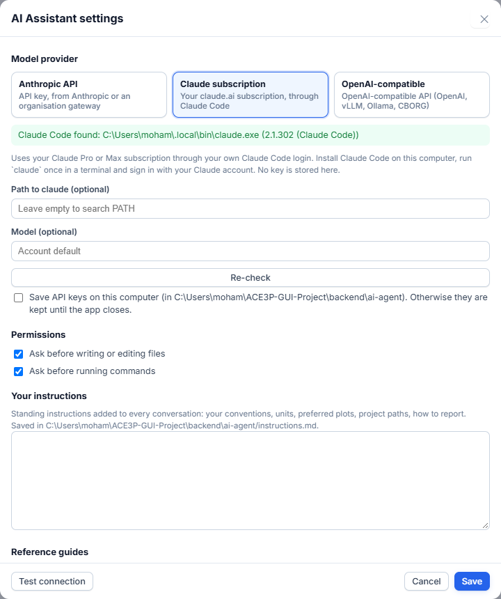
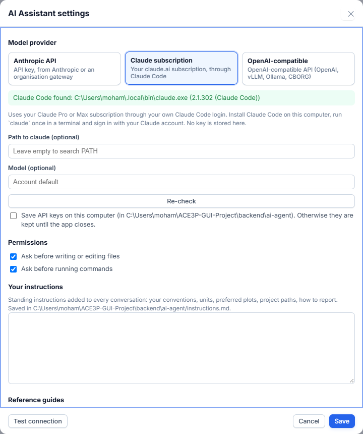
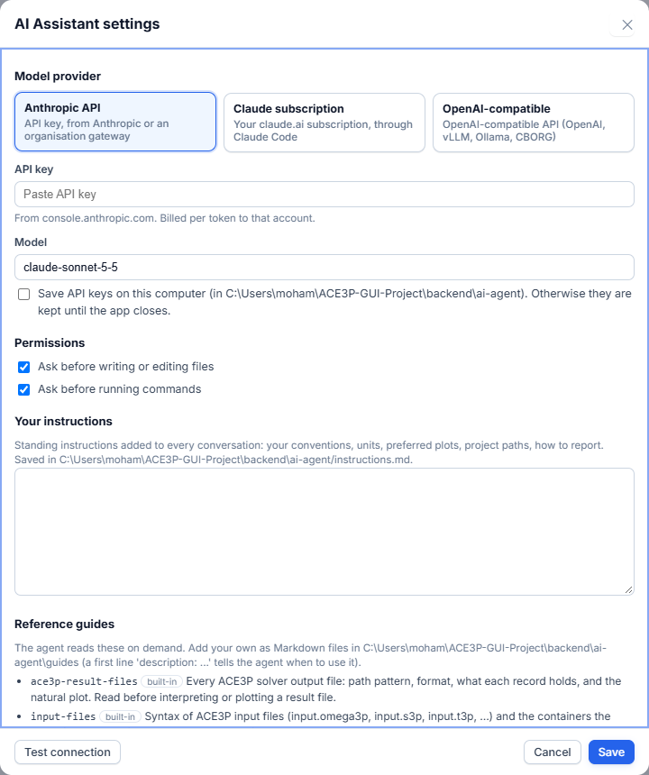
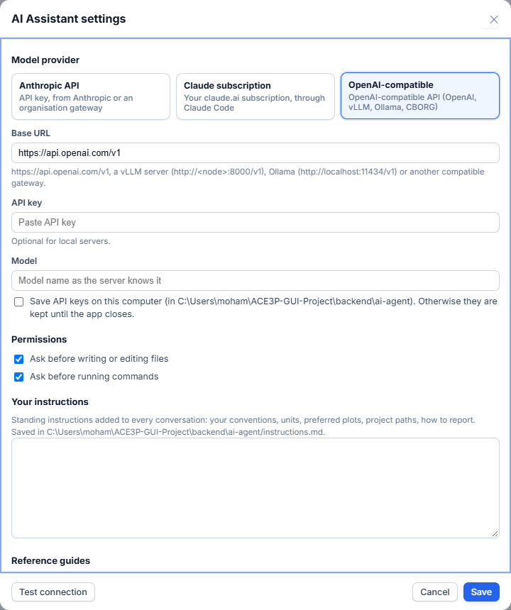

# Set up a model provider

The AI Assistant needs a language model. Open the **AI Assistant** tab, press
**⚙**, choose one of three providers, fill it in, press **Test connection**,
then **Save**.



| Provider | You supply | Billing |
|---|---|---|
| **Claude subscription** | A Claude Pro or Max account, signed in through Claude Code on the computer running the app | Your subscription |
| **Anthropic API** | An API key from console.anthropic.com, or an organisation gateway's key and URL | Per token, to that account |
| **OpenAI-compatible** | A base URL, a model name and (if required) a key: OpenAI, a vLLM server, Ollama, CBORG or another gateway | Depends on the server |

**Test connection** sends one real request. A pass means the provider works
end to end. On failure it shows the HTTP status and a hint:

| Status | Meaning |
|---|---|
| 401 / 403 | Wrong key or wrong key header |
| 404 | Wrong URL, or the endpoint speaks the other API format |
| 400 | Usually a wrong model name |

## Claude subscription



This provider uses Claude Code, signed in with your Claude account. It is set
up once on the computer that runs the app (on a cluster: on that login node).

1. Install Claude Code.

    === "Windows (PowerShell)"

        ```powershell
        irm https://claude.ai/install.ps1 | iex
        ```

    === "Linux, macOS, clusters"

        ```bash
        curl -fsSL https://claude.ai/install.sh | bash
        ```

2. Open a new terminal and sign in. A browser opens; sign in with your
   subscription's email. Add `--sso` for organisation single sign-on.

    ```bash
    claude auth login
    ```

3. Check the login. The output must contain `"loggedIn": true`.

    ```bash
    claude auth status
    ```

4. In the app, choose **Claude subscription** and press **Re-check**. The green
   line shows the path and version of Claude Code. If the app was already
   running when you installed Claude Code, restart the app first.
5. If Re-check cannot find Claude Code, enter its path in
   **Path to claude**. On Windows it is usually
   `%USERPROFILE%\.local\bin\claude.exe`.
6. **Model** is optional: `sonnet`, `opus`, `haiku`, or empty for your
   account's default.
7. Press **Test connection**, then **Save**.

The app never sees your Claude credentials. A Pro or Max subscription does not
include API keys; this route is how the subscription is used from the app.

## Anthropic API



1. Choose **Anthropic API**.
2. Paste the **API key** from console.anthropic.com.
3. Pick a **Model**, for example `claude-sonnet-5-5`.
4. Press **Test connection**, then **Save**.

### Through an organisation gateway

If your organisation gives you a key for its own endpoint, find out from its
documentation which format the endpoint speaks.

- **OpenAI format** (paths end in `/chat/completions`, or the documentation
  says "OpenAI-compatible"): use the OpenAI-compatible provider below. This is
  the simpler route.
- **Anthropic format** (paths end in `/v1/messages`, or the documentation says
  "Anthropic SDK" or "Claude API"): choose **Anthropic API**, paste the key and
  enter the model name the gateway lists. The endpoint and key header are not
  in the dialog. Set them in `settings.json` in the app's AI folder (see
  [API keys](#api-keys) for the folder), with the app closed:

    ```json
    {
      "anthropic_base_url": "https://gateway.example.org/anthropic",
      "anthropic_auth": "bearer",
      "anthropic_headers": "X-Project: my-project"
    }
    ```

    - `anthropic_base_url`: the gateway URL. The base, or the URL ending in
      `/v1` or `/v1/messages`, all work.
    - `anthropic_auth`: `bearer` sends `Authorization: Bearer <key>`;
      `x-api-key` (the default) sends `x-api-key: <key>`.
    - `anthropic_headers`: extra headers, one `Name: value` per line.

    Keep the other keys of the file as they are. Alternatively, set the
    environment variable `ACE3P_ANTHROPIC_BASE_URL` before starting the app.

## OpenAI-compatible



1. Choose **OpenAI-compatible**.
2. **Base URL:** everything up to and including `/v1`.

    | Server | Base URL |
    |---|---|
    | OpenAI | `https://api.openai.com/v1` |
    | vLLM on a NERSC GPU node | `http://<node>:8000/v1` or the proxy `http://127.0.0.1:8077/v1` (see [vLLM on NERSC](vllm.md)) |
    | Ollama on your computer | `http://localhost:11434/v1` |
    | A gateway (for example CBORG) | The URL from its documentation |

3. **API key:** required by hosted services, optional for local servers.
4. **Model:** the model name exactly as the server lists it.
5. Press **Test connection**, then **Save**.

The model must support tool calling. Without it, the assistant can only chat
and cannot read files or plot.

## API keys

By default, keys are kept in memory and forgotten when the app closes. Tick
**Save API keys on this computer** to store them in the app's AI folder
(`%LOCALAPPDATA%\ACE3P-GUI\ai-agent` on Windows,
`~/.local/share/ACE3P-GUI/ai-agent` on Linux). The page never receives a key
back: settings show only whether a key is set and its last four characters.

When no key is entered, the environment variables `ANTHROPIC_API_KEY` and
`OPENAI_API_KEY` are used. `HTTPS_PROXY` is honoured.

## Permissions

| Setting | Default | Effect |
|---|---|---|
| Ask before writing or editing files | On | Every write shows a diff to approve. |
| Ask before running commands | On | Every shell command needs approval. |
