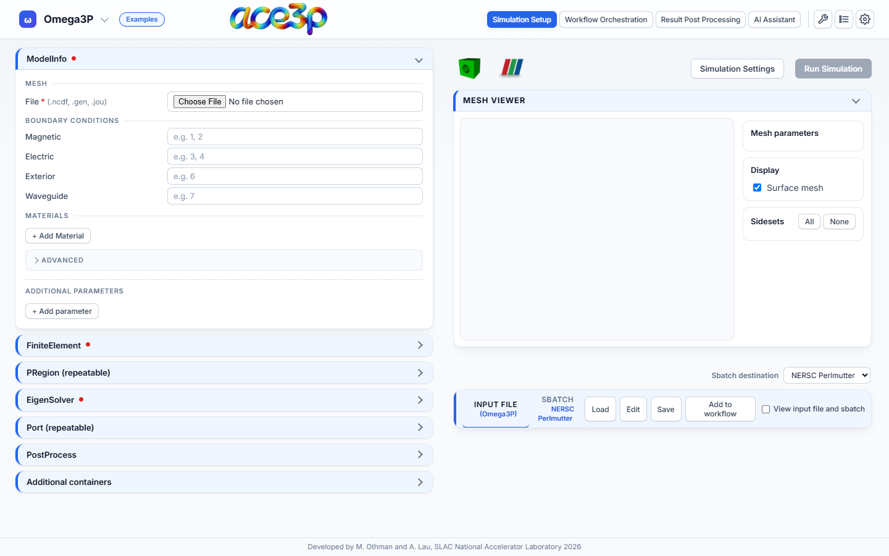
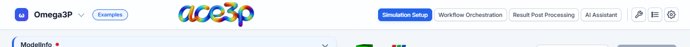
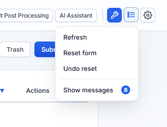
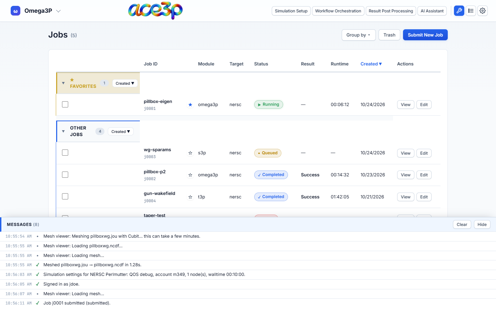
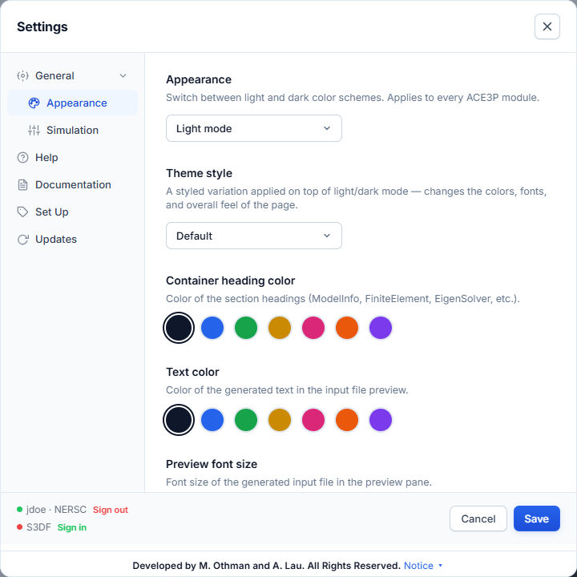
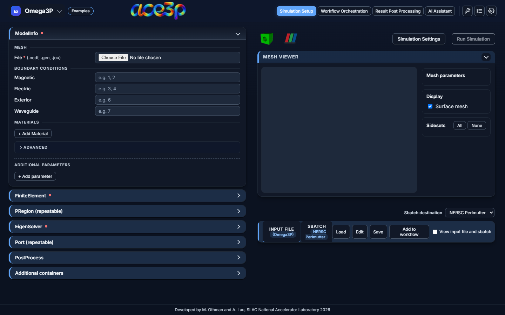

# The interface

The app opens on **Simulation Setup** with an empty Omega3P form.

## Header

From left to right:

| Control | What it does |
|---|---|
| **Solver menu** (shows `Omega3P`) | Picks the ACE3P solver. See [Choose a solver](../simulation-setup/modules.md). |
| **Examples** | Opens ready-made example files. Shown on Simulation Setup and Workflow Orchestration. See [Examples](../simulation-setup/examples.md). |
| Cluster badge | Appears when the app runs on Perlmutter or S3DF. Shows the cluster and your user name. |
| **Simulation Setup** | The solver editor: forms, mesh viewer, input file and sbatch preview. |
| **Workflow Orchestration** | The LUME-ACE3P builder for sweeps and optimizations. See [Workflow Orchestration](../workflow/index.md). |
| **Result Post Processing** | Acdtool, Field Viewer, Data Explorer and Workflow Sweeps. See [Result Post Processing](../post-processing/index.md). |
| **AI Assistant** | A chat assistant that reads your jobs and results. See [AI Assistant](../ai/assistant.md). |
| Wrench icon | Opens the **Jobs** dashboard. See [Monitor jobs](../running-jobs/jobs-dashboard.md). |
| List icon | The **View** menu: Refresh, Reset form, Undo reset, Messages. |
| Gear icon | **Settings**: appearance, simulation checks, help, cluster sign-in. |

The active view's tab is highlighted. One view is visible at a time. Switching
views keeps the state of the others: a form you filled stays filled while you
look at the Jobs dashboard.

## Simulation Setup layout

- **Left pane:** the solver form, one collapsible box per input-file container
  (`ModelInfo`, `FiniteElement`, `EigenSolver`, …). A red dot on a box means a
  required field inside it is empty.
- **Right pane, top:** the **Cubit** and **ParaView** launch buttons,
  **Simulation Settings** and **Run Simulation**.
- **Right pane, middle:** the **Mesh Viewer** with the Cubit parameters, display
  options and sideset list.
- **Right pane, bottom:** the **Sbatch destination** menu and the
  **Input File / Sbatch** preview with **Load**, **Edit**, **Save** and
  **Add to workflow**.

Click a pane to make it the active pane. The mouse wheel then scrolls only that
pane. Over the other pane, the wheel does nothing and a hint reads
**Click to scroll this panel**. A plot zooms with the wheel only after you click
inside it.

## View menu

| Item | What it does |
|---|---|
| **Refresh** | On the Jobs dashboard, reloads the job list or the open job. In the editor, reloads the page. |
| **Reset form** | Clears the Omega3P or S3P form and the selected mesh. |
| **Undo reset** | Restores the form cleared by the last reset. |
| **Messages** | Opens the Messages window. A badge counts unread messages and turns red when one is an error. |

## Messages window

Every status line, warning and error goes to the **Messages** window at the
bottom of the screen. Open it from **View → Messages**. Entries with more detail
expand when clicked. Repeated messages are counted (`×3`) instead of listed
again. **Clear** empties the list, **Hide** closes the window.

## Settings

The left column lists the sections: **Appearance**, **Simulation**, **Help**,
**Documentation**, **Set Up** and **Updates**. The bottom of the dialog shows
each cluster with a **Sign in** or **Sign out** link. See
[Settings](../reference/settings.md) for every option.

## Dark mode

Set **Settings → Appearance → Appearance** to **Dark mode**.

