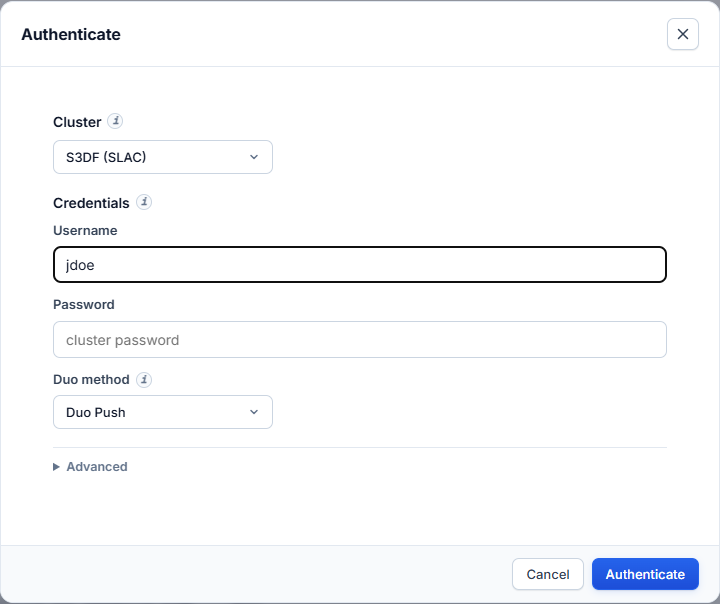

# Sign in to a cluster

Submitting, monitoring and post-processing need a session on the cluster. The
app opens **one** SSH connection per cluster and keeps it open, so you
authenticate once per session, not once per action.

!!! info "Running on the cluster itself"
    When the app runs on Perlmutter (ThinLinc) or S3DF (NoMachine), that
    cluster needs no sign-in. The header badge names the cluster and your
    account, and Settings shows **No sign-in needed** for it.

## When the app asks you to sign in

- You press **Run Simulation** and no cluster is signed in.
- You press **Sign in** next to a cluster at the bottom of **Settings**.
- You pick a cluster in the Run Simulation dialog that is not signed in.

## NERSC Perlmutter

NERSC requires your password plus a one-time code from **MobileOTP**.

1. **Cluster:** NERSC Perlmutter.
2. **Username:** your NERSC user name.
3. **Password:** your NERSC password.
4. **One-time password (OTP):** the 6-digit code shown in the MobileOTP app.
   The app appends it to the password for you. Do not type it into the
   password field yourself.
5. Press **Authenticate**.

## S3DF (SLAC)

S3DF requires your password and approval of a **Duo** push.

1. **Cluster:** S3DF.
2. **Username:** your SLAC Unix user name.
3. **Password:** your SLAC password.
4. **Duo method:** Duo Push.
5. Press **Authenticate**, then approve the push on your phone within 60 seconds.

Commands on S3DF run on the `iana` node, which has Slurm and the `/sdf` file
system. The app reaches it from the login node over the same session. The node
is set in the Run Simulation dialog under **Advanced → Compute node**. Leave it
as `iana`.

## Errors

| Message | Cause | Fix |
|---|---|---|
| Wrong password | The password (or password + OTP) was rejected. | Retype both. On NERSC wait for a fresh OTP code. |
| Duo push denied or timed out | The push was not approved within 60 s. | Press **Authenticate** again and approve the push. |
| Login shell did not respond | The login node accepted you but the shell did not start. | Try again. If it persists, log in with plain SSH to check the account. |

## Both clusters at once

You can be signed in to NERSC and S3DF at the same time. Each keeps its own
session. The Jobs dashboard then lists jobs from both clusters, and the Run
Simulation dialog lets you pick either one without signing in again.

## Sign out

Open **Settings** and press **Sign out** next to the cluster. The SSH
connection closes at once.

A session also closes after 8 hours without activity. Any activity, including
the dashboard's status polling, keeps it open. Restarting the app ends every
session.

## Your password

The password is sent once, to your own local app, which passes it to the
cluster's login prompt. It is not stored anywhere: not in the browser, not on
disk. The browser keeps only an opaque session id.
