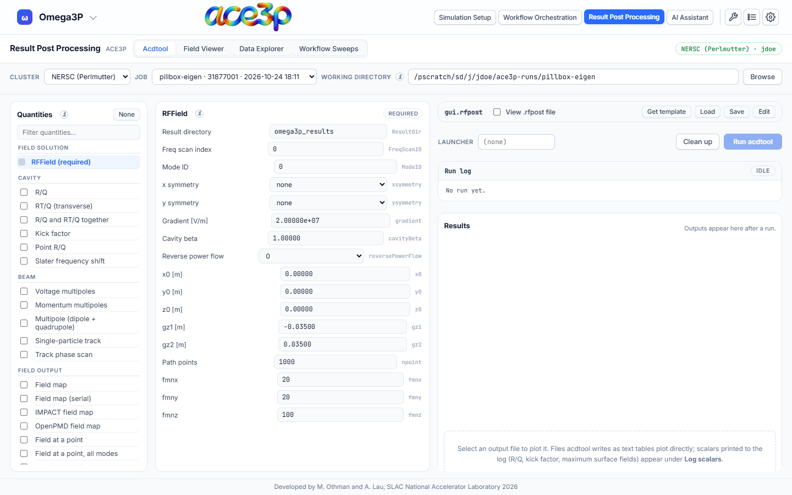

# Acdtool

The **Acdtool** tab writes an `.rfpost` file from forms and runs
`acdtool postprocess rf` on it in the working directory. Results are listed and
plotted in the same tab.

## Step by step

1. **Set the working directory** in the source bar to the run directory of a
   completed Omega3P, S3P or T3P job: the folder that **contains** the
   `<solver>_results` folder.
2. **Fill in RFField** (always required):
    - **Result directory** (`ResultDir`): the results folder, for example
      `omega3p_results`.
    - **Mode ID** (`ModeID`): the mode to analyse, counted from 0.
    - **Freq scan index** (`FreqScanID`): for S3P, the frequency index.
    - **x symmetry**, **y symmetry**: `none`, `electric` or `magnetic`, as in
      your model's symmetry planes.
    - **Gradient**, **Cavity beta**, **x0/y0/z0**, **gz1/gz2**: normalization
      and the integration line along the beam axis.
3. **Tick the quantities** to compute in the left column. Click a quantity's
   name to edit its parameters in the middle column.
4. Press **Run acdtool**.
5. Watch the **Run log**. Its badge changes from `idle` to `running` to
   `done` or `failed`.
6. Read the **Results**: the files the run produced and the scalars found in
   the log. Click a file to plot it.

## Quantities

| Group | Quantities |
|---|---|
| Cavity | R/Q, RT/Q (transverse), R/Q and RT/Q together, Kick factor, Point R/Q, Slater frequency shift |
| Beam | Voltage multipoles, Momentum multipoles, Multipole (dipole + quadrupole), Single-particle track, Track phase scan |
| Field output | Field map, Field map (serial), IMPACT field map, OpenPMD field map, Field at a point, Field at a point (all modes), Field along a line, Field along a line (all modes) |
| Surfaces | Field on the x=0 plane, Field on a surface, Peak surface fields, Power through a surface, Port power and Qext, Poynting vector, Coaxial port, Surface Q0 |

Every parameter has a tooltip with its meaning from the acdtool manual. The
grey text to the right of each field is the parameter name in the `.rfpost`
file.

Values are kept as typed: `1e9`, `100000000.00000` and `2.00000e+07` are all
written exactly so. A coordinate above `1e6` means "use the domain bound".

## The .rfpost file

The file is named `gui.rfpost`. Tick **View .rfpost file** to see it.

| Button | Effect |
|---|---|
| **Get template** | Runs acdtool to produce its own `sample.rfpost` and loads it. |
| **Load** | Opens an `.rfpost` file from your computer and fills the forms from it. |
| **Save** | Downloads the current file. |
| **Edit** | Lets you type into the file directly. The forms are ignored until you leave edit mode; leaving asks before discarding your edits. |

Quantities that are switched off are still written, with `ionoff = 0`, so the
file records everything that was considered.

## Results

- **Files:** every file the run created in the working directory, found by
  modification time. Click one to plot it: choose the **X** and **Y** columns,
  the line **Style**, **log x** / **log y**, and export with **CSV**.
- **Log scalars:** values acdtool prints but does not write to a file — R/Q,
  kick factors, peak surface fields, power through a surface — listed per mode.

## Launcher and clean-up

- **Launcher:** a prefix for the acdtool command. Leave it empty on a login
  node, where `srun` is normally refused.
- **Clean up:** removes the files this tab wrote (the wrapper, log and stamp
  files, all named `.ace3p-pp-*`). It does not remove acdtool's results.

## How the run works

The run starts in the background on the cluster and the tab polls its status,
so a long field map does not block the rest of the app. The run uses the
cluster's ACE3P environment. If acdtool is not found after loading that
environment, the tab says so before you run.
