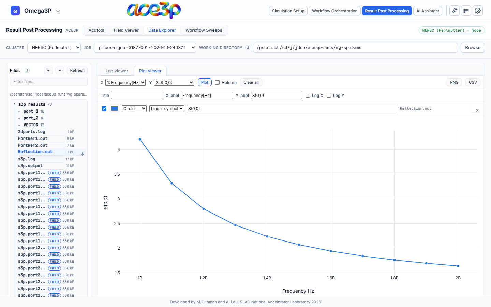
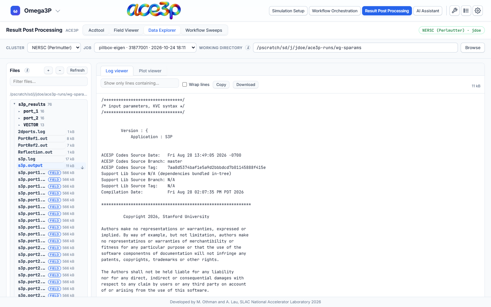

# Data Explorer

The **Data Explorer** shows the working directory as a file tree and opens any
text file in a **Log viewer** or a **Plot viewer**.

## Browse

- The **Files** card lists the working directory four folders deep, with file
  sizes. **+** and **−** expand and collapse every folder. **Refresh** lists
  again. Type in **Filter files…** to narrow the list.
- `.mod` files carry a **FIELD** tag. Clicking one opens it in the
  [Field Viewer](field-viewer.md).
- Every row has a download button.
- Drag the right edge of the Files card to make it wider. Double-click the edge
  to reset it.

## Log viewer

Click a log or text file to read it.

| Control | Effect |
|---|---|
| Show only lines containing… | Filters the lines |
| Wrap lines | Wraps long lines |
| Copy | Copies the text |
| Download | Saves the file |

A file over 2 million characters shows its first and last million characters.
Files over 24 MB cannot be opened here; download them instead.

## Plot viewer

A file made mostly of numeric columns (for example `Reflection.out`,
`SParameter.out`, an acdtool field-along-a-line file) opens in the Plot viewer
and is plotted at once: column 1 against column 2.

1. Choose the **X** and **Y** columns and press **Plot**.
2. To compare curves, tick **Hold on** and plot again, from the same file or
   another one. Each curve becomes a series.
3. Edit the **Title**, **X label** and **Y label**. Tick **Log X** or
   **Log Y** for logarithmic axes.
4. Each series row sets visibility, colour, symbol, line style and legend name.
   **×** removes it. **Clear all** removes every series.
5. Export with **PNG** or **CSV**.

Held series keep their data when you open another file, so curves from
different runs can be compared on one plot.
