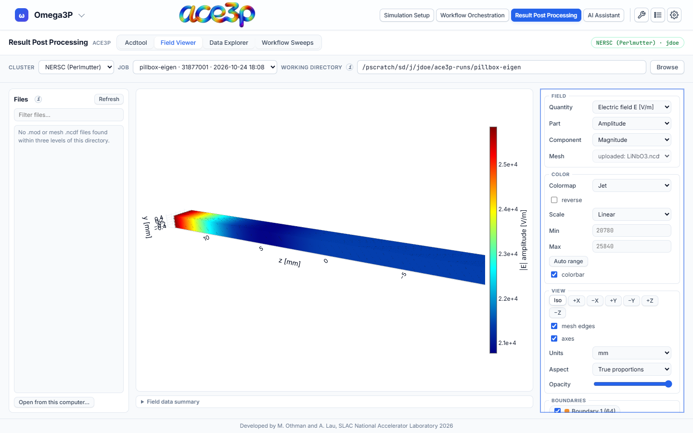

# Field Viewer

The **Field Viewer** draws a field file (`.mod`) as a coloured surface on its
mesh, or a mesh (`.ncdf`) coloured by boundary id, in 3-D in the browser. No
ParaView is needed.

## Open a file

**From the cluster:**

1. Set the working directory in the source bar to the run directory.
2. Press **Refresh** in the **Files** card. The card lists the `.mod` and mesh
   `.ncdf` files up to three folders deep.
3. Click a file.

For a `.mod`, the mesh is found automatically: the nearest `.ncdf` in the same
folder, the parent folder, or the working directory, with the same node count.
The **Mesh** menu shows which mesh is used and lets you pick another.

**From your computer (no sign-in needed):**

1. Press **Open from this computer…** at the bottom of the Files card.
2. Select a `.mod` and its mesh `.ncdf` together, or only one of them.

A `.mod` opened without a mesh is drawn on its own wall triangles only.
Real-valued fields (T3P snapshots, Gun3P static fields) need the mesh.

## Controls

**Field**

| Control | Options |
|---|---|
| Quantity | Electric field E, magnetic field B, power density, or the fields the file holds |
| Part | Amplitude, real, imaginary, or phase snapshot (with a phase slider) |
| Component | Magnitude, x, y, z |
| Mesh | The mesh the field is drawn on |

**Color**

| Control | Effect |
|---|---|
| Colormap, reverse | Colour scale |
| Scale | Linear, log, or symmetric about zero |
| Min, Max | Fix the colour range. **Auto range** resets it. |
| colorbar | Show or hide the colour bar |

**View**

| Control | Effect |
|---|---|
| Iso, ±X, ±Y, ±Z | Camera presets |
| mesh edges | Draw the element edges |
| axes | Show the axes |
| Units | Length unit of the axes |
| Aspect | **True proportions**, **Cube** (stretch every axis to the same length) or **Custom** |
| Opacity | Surface transparency |

**Boundaries** lists every boundary id with a checkbox to show or hide it.

**Field data summary** under the plot lists the file name, frequency or time,
Q, losses, stored energy, node and face counts, and the extent of the model.

Changing quantity, part, colour or view does not reload the file. The camera
stays where you put it until you open another file.

## Limits

Each file is limited to 400 MB. A damaged or foreign file is reported with a
message instead of being drawn.
