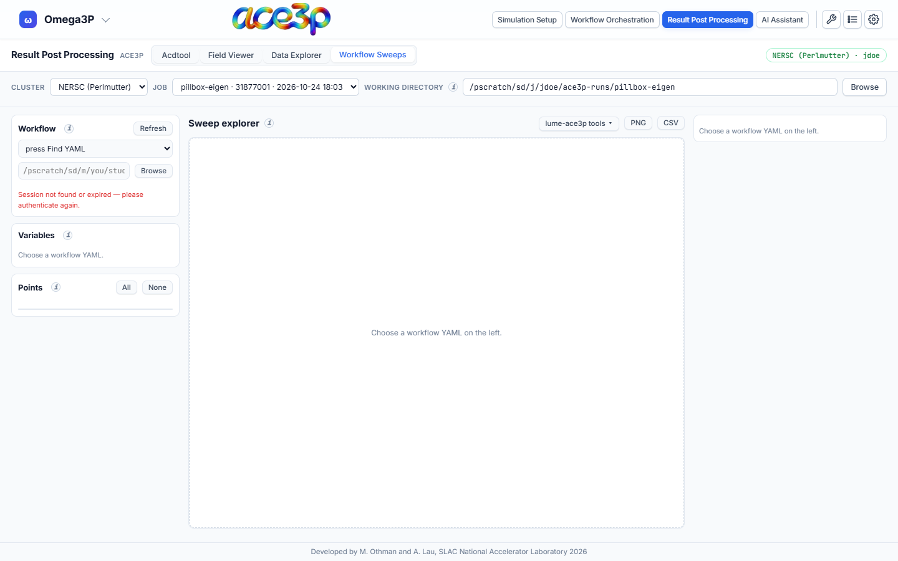

# Workflow Sweeps

**Workflow Sweeps** plots one result across every evaluation of a LUME-ACE3P
study submitted from [Workflow Orchestration](../workflow/index.md).

## Load a study

1. Set the working directory in the source bar to the study's run directory.
2. In **Workflow**, pick the study's YAML file from the list, or type its
   absolute path and press ++enter++, or press **Browse**. When the working
   directory holds exactly one YAML, it is loaded automatically.
3. **Variables** lists every input of the study. Swept inputs are marked; for
   an optimization the bounds are shown.
4. **Points** lists one row per evaluation folder with its input values. Untick
   a point to leave it out of the plots. **All** and **None** select every
   point or none.

The input values of each point are read from that point's own journal and
input file. A point whose files disagree with the value LUME-ACE3P recorded is
marked **≠**.

**Refresh** lists the directory again and re-reads the study, for example
while it is still running.

## Sweep explorer

1. **Result file:** choose a file by its path inside a point folder, for
   example `s3p_results/Reflection.out` or `omega3p_results/omega3p.out`.
2. Press **Load**. The file is read from every selected point.
3. Choose the **X** and **Y** columns, or a scalar.
4. Choose the plot type:

| Plot type | Shows |
|---|---|
| Curves | One curve per point, on top of each other. Colour by a parameter (with a colour bar) or by point. A slider highlights one point. |
| Colour map vs one parameter | The X column against one swept parameter, coloured by Y. |
| Colour map over two parameters | Two swept parameters, coloured by a number taken from each curve. |
| Quantity vs parameter | A number from each curve against one parameter, one line per value of a second parameter. |

For the last two types, each curve is reduced to one number: the value at a
given X, maximum, minimum, mean, first, last, X at maximum, or X at minimum.

Every other swept parameter gets a slider that holds it at one value. Optional
3-D surface, log Y, log colour and six colour maps are available. Export the
plot with **PNG** and the plotted data with **CSV**.

## Plot styling

The right-hand column sets the **Title**, **X label**, **Y label**, **Colour
bar** label, **Log X**, **Log Y** and **Legend**. **Series** lists every curve
with visibility, colour, symbol, line style and legend name. **Reset style**
returns to the automatic labels and colours.

## lume-ace3p tools

The **lume-ace3p tools ▾** menu opens in-browser versions of the plotting
scripts that ship with LUME-ACE3P:

| Tool | Original script |
|---|---|
| S3P parameter-sweep viewer | `s3p_sweep_plot.py` |
| S3P optimization viewer | `s3p_xopt_plot.py` |
| Optimization iterations (static) | `xopt_plot_still.py` |
| Parameter-space exploration | `xopt_param_sweep_plot.py` |

Each tool reads the same text tables as the original script. **Load scripts
from this computer…** in the same menu opens your copies of these scripts and
picks the matching tool. **Script** shows the loaded script's source. The menu
also returns to the Sweep explorer.

## Limits

- At most 2000 files and 96 MB are read per load; the tab asks before reading
  more than about 64 MB.
- A table longer than 20 000 rows is thinned to evenly spaced rows.
- Large particle dumps (runs of thousands of numbered files) are listed as one
  series and are not offered for loading.
