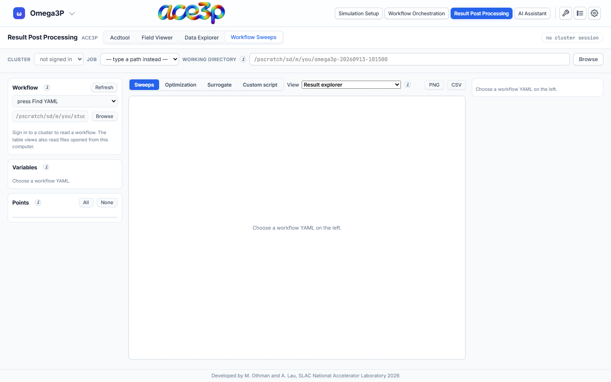
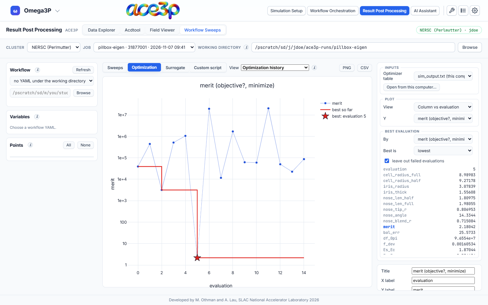
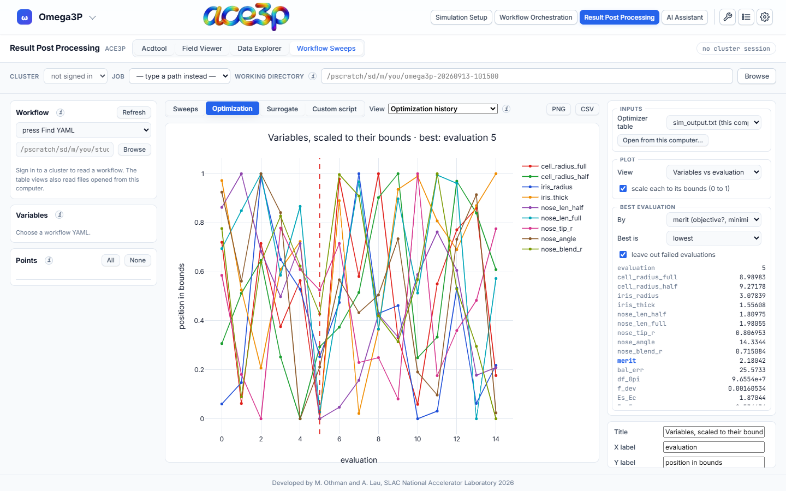
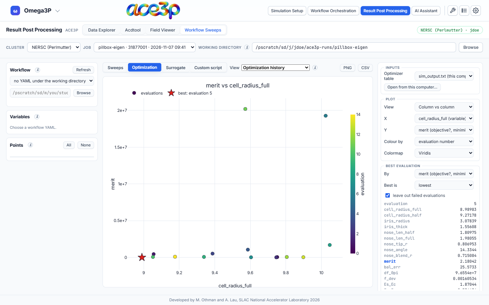
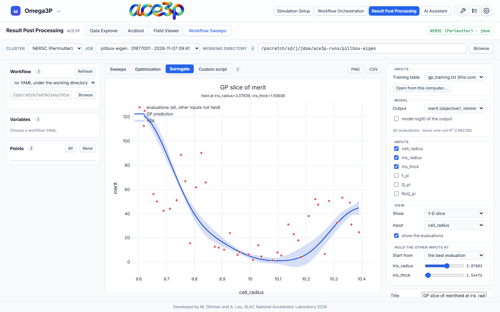
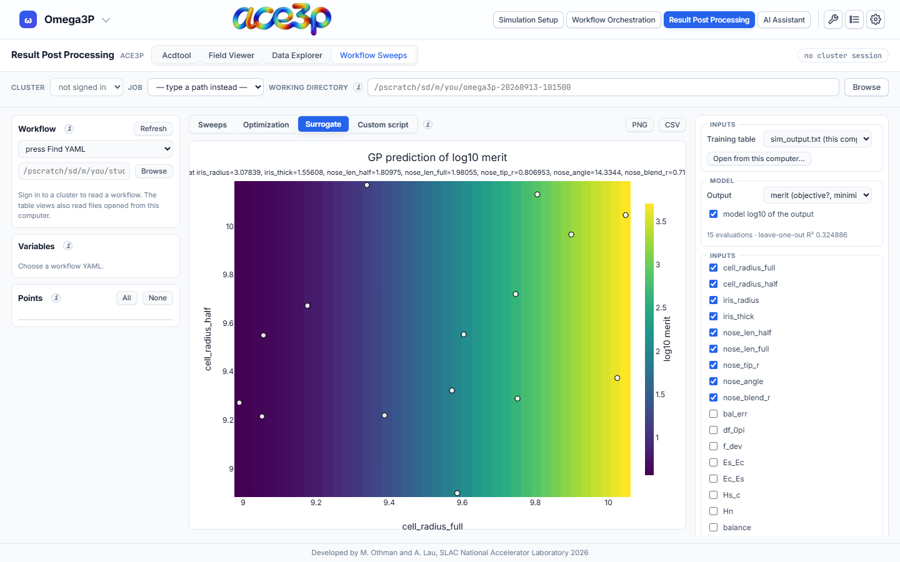
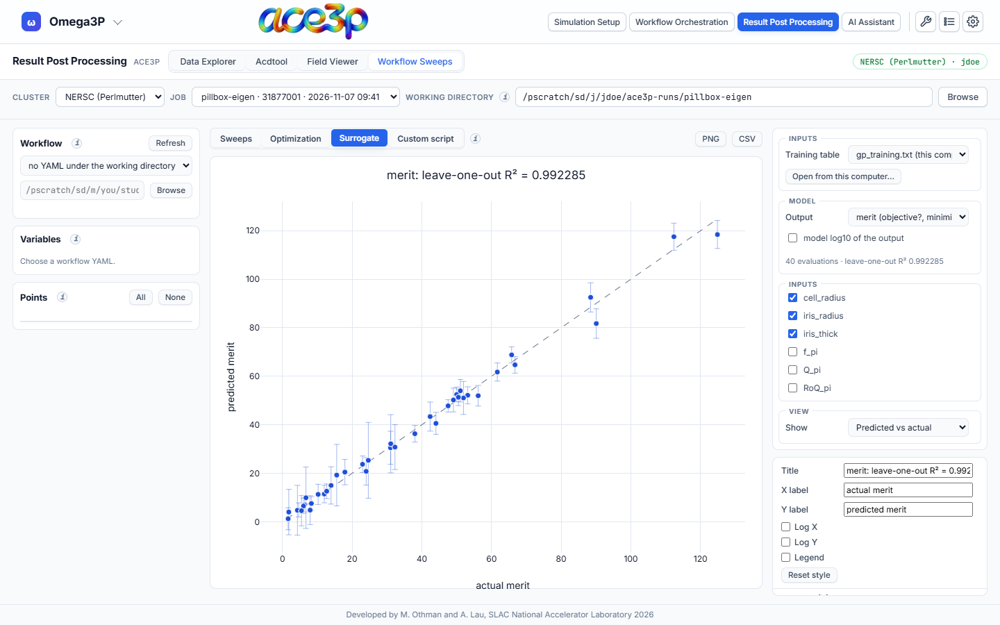
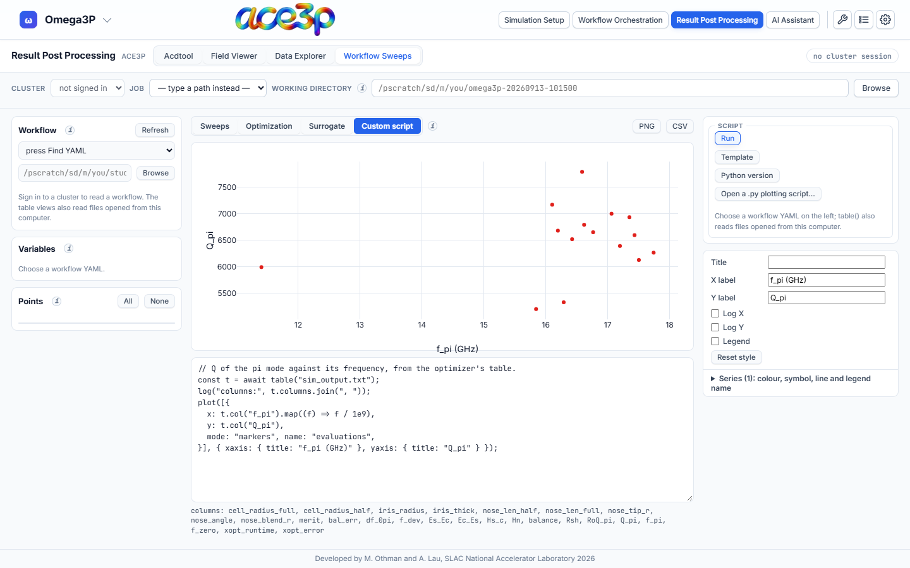

# Workflow Sweeps

**Workflow Sweeps** plots the results of a LUME-ACE3P study submitted from
[Workflow Orchestration](../workflow/index.md): a parameter sweep, an
optimization or a surrogate-model study. It reads every evaluation folder of
the study, or the study's result tables, and plots them in the browser.



The tab has three columns:

- **Left:** the study: **Workflow** (its YAML), **Variables** and **Points**.
- **Middle:** the plot, with four study-type tabs above it — **Sweeps**,
  **Optimization**, **Surrogate**, **Custom script** — a **View** menu, the
  **ⓘ** description of the current view, and **PNG** and **CSV** export.
- **Right:** the controls of the current view, then the plot styling.

## Load a study

1. In the source bar, set **Working directory** to the study's run directory.
2. In **Workflow**, pick the study's YAML from the list. The list holds the
   YAML files found under the working directory. You can also type the YAML's
   absolute path and press ++enter++, or press **Browse**. When the working
   directory holds exactly one YAML, it is read automatically.
3. The study opens on the tab that matches its run mode: **Sweeps** for a
   parameter sweep, **Optimization** for an optimization, **Surrogate** for a
   GP surrogate study. You can switch tabs at any time.

**Variables** lists every input of the YAML. Swept inputs are marked on the
left edge; for an optimization, each variable's bounds are shown.

**Points** lists one row per evaluation folder with its input values.

- Untick a point to leave it out of every plot. **All** and **None** select
  every point or none.
- The values come from each point's own Cubit journal and solver input file,
  not only from what LUME-ACE3P recorded. A point whose files disagree with the
  recorded value is marked **≠**.

**Refresh** lists the YAML files again and re-reads the study. Use it while a
study is still running to pick up new points.

!!! tip "Tables without a study"
    The Optimization and Surrogate views, and `table()` in Custom script, also
    work on tables opened from your computer, with no cluster session: press
    **Open from this computer…** in the view's **Inputs** group and choose, for
    example, a downloaded `sim_output.txt`.

## Sweeps

For parameter sweeps. Pick the view in the **View** menu.

| View | What it shows |
|---|---|
| **Result explorer** | One result file read from every evaluation folder, plotted across the study. |
| **Curves with parameter sliders** | Every point's curve drawn faintly, the selected point in bold, with a slider per swept parameter. |
| **Parameter map with optimizer path** | One quantity as a colour map over two swept parameters, with an optimizer's evaluations drawn on top. |

### Result explorer

1. **Result file:** choose a file by its path inside an evaluation folder, for
   example `omega3p_results/omega3p.out`, `s3p_results/SParameter.out` or a
   T3P monitor file. Only files that hold data to plot are listed.
2. Press **Load**. The file is read from every point in use.
3. Under **Data**, choose the **X** and **Y** columns, or a value the solver
   printed (for example a T3P kick factor).
4. Under **Plot**, choose the **Type**:

| Type | Shows |
|---|---|
| Curves on top of each other | One curve per point. **Colour by** a parameter (with a colour bar), or leave it empty for one distinct colour per point. |
| Quantity vs evaluation | One number per point against the evaluation number. |
| Quantity vs parameter | One number per point against one parameter, one line per value of a second parameter. |
| Map: parameter vs parameter | One number per point as a colour map over two parameters. |
| Colour map: X column vs parameter | The X column against one parameter, coloured by Y. |

For the types that need one number per point, **Reduce Y to** picks it: the
value at a given X, maximum, minimum, mean, first value, last value, X at
maximum, or X at minimum.

In a sweep, every swept parameter not on an axis gets a slider that holds it at
one value. **Highlight → Point** draws one point's curve in bold. Options:
**Colormap** (jet first), **log colour**, **3-D surface** for the maps, and
**best so far** for Quantity vs evaluation.

In an optimization nothing is held: every evaluation is shown, and the maps and
Quantity vs parameter draw scattered points.

### Curves with parameter sliders and the other curve views

Under **Data → From**, choose where the curves come from:

- **a result file in every point** — the same file as in the Result explorer,
  then the **X column**;
- **one long-format table** — a table with the parameters, an **Index column**
  (frequency, mode, time) and the quantities, such as a sweep's output table.

These views work with any curve: an S-parameter spectrum, the mode frequencies
of `omega3p.out`, a T3P monitor signal. They do not depend on a particular
column name.

**Parameter map with optimizer path** reads a **Sweep table** and, optionally,
an **Optimization table**. It draws one quantity at one value of the index
column (an S-parameter at one frequency, a mode's frequency) over two swept
parameters, with the optimizer's evaluations drawn from dark to light in the
order they were run. It can be animated or shown as a 3-D surface.

## Optimization

For Xopt optimizations. **Optimization history** opens first.



| View | What it shows |
|---|---|
| **Optimization history** | The optimizer's own table, one row per evaluation. |
| **Result explorer** | A result file from every evaluation folder (see above). |
| **Curve of one evaluation** | One evaluation's curve, with sliders for the evaluation and the quantity. Target X positions are marked when the table names them. |
| **Curves of several evaluations** | Several evaluations' curves in distinct colours: all, the last N, every Nth, or a list. |

### Optimization history step by step

1. Under **Inputs → Optimizer table**, choose the table. It is found next to
   the YAML (`sim_output.txt` unless the YAML names another file), or opened
   with **Open from this computer…**.
2. Under **Plot → View**, choose:
    - **Column vs evaluation** — a column against the evaluation number, with
      the best value so far as a red line and the best evaluation as a star.
      Columns spanning more than three decades get a log axis.
    - **Column vs column** — two columns against each other, coloured by a
      third.
    - **Variables vs evaluation** — every variable's path, scaled to its bounds
      when **scale each to its bounds (0 to 1)** is ticked.
3. Under **Best evaluation**, choose the column the best evaluation is judged
   by (**By**) and whether the best is the **lowest** or **highest**. Tick
   **leave out failed evaluations** to ignore rows Xopt marked as errors. The
   best evaluation's full row is listed below.

The column names are labelled from the YAML: variables, objectives (with their
direction), constraints and outputs. Without the YAML, a `merit`, `objective`
or `cost` column is taken as the objective and the columns to its left as the
variables; the objective is then marked `objective?`.





## Surrogate

**Gaussian-process surrogate** fits a Gaussian-process model to a table of
evaluations — an optimizer's `sim_output.txt`, a sweep's output table, a GP
study's training data — and draws it. The model is fitted in the page.



1. **Inputs → Training table:** choose the table.
2. **Model → Output:** the column to model. Tick **model log10 of the output**
   for a quantity that spans several decades. The line below gives the number
   of evaluations and the leave-one-out R².
3. **Inputs:** tick the columns the model uses as inputs. The optimizer's
   variables are ticked by default.
4. **View → Show:**
    - **1-D slice** — the prediction along one **Input** with its ±2σ band.
      Tick **show the evaluations** to draw the data points.
    - **2-D map** — the prediction, or its uncertainty (σ), over two inputs.
    - **Predicted vs actual** — each evaluation predicted by a model fitted
      without it. Points near the diagonal mean the model can be trusted.
5. **Hold the other inputs at:** **Start from** the best evaluation or the
   median, then adjust each held input with its slider.





!!! note "How far to trust the model"
    Read the leave-one-out R² before using a slice or a map. A value near 1
    means the model predicts evaluations it has not seen. A low value, such as
    0.32 for the 15 evaluations above, means the model needs more data and its
    slices show trends only.

## Custom script

**Custom script** runs a short script that you write below the plot. Use it for
any plot the other views do not make.



The script is JavaScript and runs in the page. It has:

| Name | What it gives |
|---|---|
| `points` | The evaluation folders in use: `{name, index, values}` |
| `await read(file)` | `file` read from every point: a list of `{point, table, col(name)}` |
| `await table(name)` | A table beside the YAML (such as `sim_output.txt`) or opened from this computer, with `columns` and `col(name)` |
| `plot(traces, layout)` | Draws with Plotly |
| `log(...)` | Prints below the editor |

The example above:

```javascript
// Q of the pi mode against its frequency, from the optimizer's table.
const t = await table("sim_output.txt");
log("columns:", t.columns.join(", "));
plot([{
  x: t.col("f_pi").map((f) => f / 1e9),
  y: t.col("Q_pi"),
  mode: "markers", name: "evaluations",
}], { xaxis: { title: "f_pi (GHz)" }, yaxis: { title: "Q_pi" } });
```

| Button | Effect |
|---|---|
| **Run** (++ctrl+enter++) | Runs the script. |
| **Template** | Replaces the script with the starting template, which plots one value of a result file from every point. |
| **Python version** | Downloads a matplotlib script that makes the same kind of plot from the evaluation folders on the cluster. |
| **Open a .py plotting script…** | Opens a LUME-ACE3P plotting script from your computer and switches to the matching view. |

The script is saved in your browser and is there when you come back.

## Plot styling

The bottom of the right column styles whatever the current view draws:
**Title**, **X label**, **Y label**, **Colour bar** label, **Log X**, **Log Y**,
**Legend**, and **Series** — visibility, colour, symbol, line style and legend
name of each curve. Labels you type are kept until the view changes its axes.
**Reset style** returns to the automatic labels and colours.

**PNG** saves the plot. **CSV** saves the data that is plotted.

## Limits

- At most 2000 files and 96 MB are read per load. The tab asks before reading
  more than about 64 MB.
- A table longer than 20 000 rows is thinned to evenly spaced rows.
- Large runs of numbered files, such as Track3P particle dumps, are listed as
  one series and are not offered for loading.
- The surrogate model uses at most 250 evaluations.
