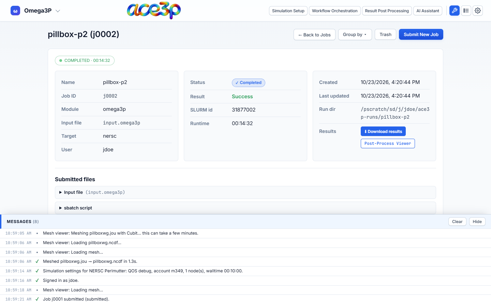
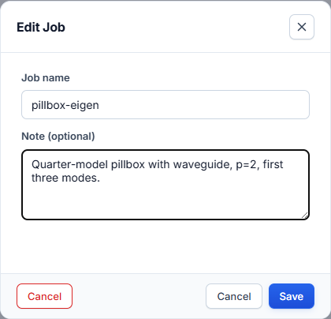

# Monitor jobs

Open the **Jobs** dashboard with the wrench icon in the header.

The list shows the jobs of every cluster you are signed in to. It refreshes
every 30 seconds while it is open. **View → Refresh** reloads it at once.

## Columns

| Column | Content |
|---|---|
| Checkbox | Selects the job for bulk deletion. |
| Job ID | Job name (if given) and the app's job id. |
| ☆ | Favorite. Click to pin the job to **★ Favorites**. |
| Module | The solver. |
| Target | `nersc` or `s3df`. |
| Status | Submitted, Queued, Running, Completed, Failed, Cancelled. |
| Result | Success or Fail once the job has ended. |
| Runtime | Elapsed time reported by Slurm. |
| Created | Submission date. |
| Actions | **View** and **Edit**. |

Click a column heading to sort by it; click again to reverse. **Group by**
groups the rows by module or by cluster. Each group has its own sort menu and
can be collapsed with its ▸ arrow.

## Job status

| Status | Meaning |
|---|---|
| **Submitted** | `sbatch` accepted the job. |
| **Queued** | Slurm state `PENDING`: waiting for nodes. |
| **Running** | Slurm state `RUNNING`. |
| **Completed** | Slurm state `COMPLETED`: the script exited with code 0. |
| **Failed** | Slurm state `FAILED`, `TIMEOUT`, `OUT_OF_MEMORY` or `NODE_FAIL`. |
| **Cancelled** | The job was cancelled. |

!!! note
    **Completed** means the batch script finished without an error code. Check
    the output log to confirm the solver converged.

## Job detail

Press **View** on a job.

- **Status pill** (top left): Slurm state and runtime, polled while the page is
  open.
- **Info cards:** name, job id, solver, input file, cluster, user, Slurm id,
  creation time and run directory.
- **Submitted files:** the input file and sbatch script exactly as submitted.
- **Logs:** the end of `<solver>-<jobid>.out`. Press **error** for the `.err`
  file. Both refresh while the job runs.
- **Results:** available once the run directory has output.

**← Back to Jobs** returns to the list.

## Results

| Button | What it does |
|---|---|
| **Download results** | Packs the whole run directory into one `.tar.gz` on the cluster, downloads it, and removes the archive from the cluster. |
| **Post-Process Viewer** | Omega3P, S3P and T3P jobs that completed: draws the fields of the `.mod` files on the mesh in the browser. |

For acdtool post-processing and plots of result tables, open
[Result Post Processing](../post-processing/index.md).

### Post-Process Viewer

The viewer downloads the mesh and the mode files from the run directory and
draws them.

- **Mode:** pick the mode (Omega3P) or frequency (S3P).
- **Time** slider and **Play** (T3P): step through the saved time steps.
- **Fields:** the quantity to colour by.
- **Color range:** fix the minimum and maximum.
- **Symmetry:** mirror the model across X or Y to show the full structure of a
  quarter or half model.
- **Sidesets:** show or hide boundary surfaces.

## Edit, cancel and delete

Press **Edit** on a job.

- **Name:** the label shown in the list.
- **Note:** a longer description for your own records.
- **Cancel** (queued or running jobs): runs `scancel` on the cluster.
- **Delete** (finished jobs): moves the job to the Trash. The files on the
  cluster are not touched.

Press **Save** to keep name and note changes.

To delete several jobs, tick their checkboxes and press **Delete Selected**.

## Trash

Press **Trash** to see deleted jobs.

- **Restore** puts a job back in the list.
- **Delete forever** removes it from the history for good. A permanently
  deleted job does not come back on the next sync.

## History on several computers

Job history follows your cluster account, not the computer. When you sign in,
the dashboard merges:

1. your ACE3P jobs from the last 30 days of Slurm history (`sacct`), and
2. a small state file the app keeps in your cluster home directory,
   `~/.ace3p_gui_state.json`.

Names, notes, favorites and deletions therefore appear on every computer you
use. A job first seen on another computer shows its status, logs and results,
but not the original input file and sbatch script. Jobs older than 30 days and
not in the state file do not appear.
