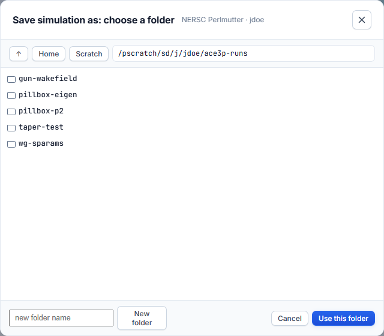
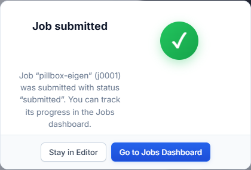

# Run a simulation

A simulation lives in a **folder on the cluster**. **Run Simulation** saves the
input file, the mesh and the batch script into that folder and submits the job
in one step. There is no dialog to fill in.

## The toolbar

The bar under the header holds, from left to right:

| Control | What it does |
|---|---|
| Cubit and ParaView logos | Open those applications. See [Mesh and Cubit parameters](../simulation-setup/mesh.md#cubit-and-paraview-buttons). |
| Folder path | The simulation's folder on the cluster, once one is set. |
| **Load simulation** | Opens an input file on the cluster. The mesh in the same folder is loaded with it. |
| **Save** | Writes the input file, the mesh and `submit.sbatch` into the simulation's folder. |
| **Save as…** | Asks for a folder, writes the files there, and makes it the simulation's folder. |
| **Simulation Settings** | Cluster, Slurm resources and the job name. See [Simulation Settings](../simulation-setup/simulation-settings.md). |
| **Run Simulation** | Saves into the folder and submits. |

The same five buttons sit in the same place in
[Workflow Orchestration](../workflow/index.md), where they act on the study.

## Set the simulation's folder

A simulation needs a folder before it can run. Either:

- press **Save as…**, pick or create a folder on the cluster, and press
  **Use this folder**, or
- press **Load simulation** and open an input file that is already on the
  cluster. Its folder becomes the simulation's folder.

In the folder picker:

- **Home** and **Scratch** jump to those folders.
- Type a path into the box and press ++enter++ to go there.
- **New folder** creates a folder in the current location.

Use a scratch file system. It is fast and has room for large result files.

| Cluster | Example folder |
|---|---|
| NERSC Perlmutter | `/pscratch/sd/<first letter>/<user>/ace3p-runs/<job>` |
| S3DF | `/sdf/scratch/users/<first letter>/<user>/ace3p-runs/<job>` or your group's `/sdf/data/...` area |

Files are always read from and written to a cluster: the one the app runs on
(on a Perlmutter or S3DF desktop), otherwise NERSC Perlmutter first. If no
cluster is signed in, the sign-in dialog opens.

## When Run Simulation turns green

**Run Simulation** is grey until everything below is true. Hover over it to see
what is still missing.

1. **Signed in** to the cluster the folder is on.
2. **A folder** is set (Save as… or Load simulation).
3. **Mesh:** a `.jou`, `.gen` or `.ncdf` is selected (not needed for Track3P).
4. **Input file:** no required field is empty.
5. **Boundary conditions:** every sideset of the mesh has exactly one boundary
   condition. A sideset with none, or a sideset listed under two conditions,
   keeps the button grey.
6. **Sbatch script:** generated for the cluster.

To submit with required fields empty, turn off
**Settings → Simulation → Parameter safety**.

## Press Run Simulation

The files are written into the folder and `sbatch submit.sbatch` runs there.
Progress shows on the button (**Submitting… 70%**) and in the Messages window.
On success a confirmation offers **Go to Jobs Dashboard**.

The job carries the **Job name** from Simulation Settings, if you set one.
Result Post Processing remembers the folder and opens on it next time.

## What is written into the folder

| File | Name in the folder |
|---|---|
| Mesh | Its own name, for example `pillboxwg.jou` |
| Input file | `input.<solver>`, for example `input.omega3p` |
| Batch script | `submit.sbatch` |

Rules:

- Files go into the folder **exactly as named**. No subfolder is created.
- A folder that holds a submitted, queued or running job of yours is refused.
  Use one folder per running job.
- Running again in the folder of a finished job overwrites its input files.
  Results of the earlier run that are not overwritten stay in place. Use
  **Save as…** to start a new folder and keep runs apart.

## Common submission errors

| Error | Cause | Fix |
|---|---|---|
| Folder already holds a running job | Another job of yours is active in that folder. | **Save as…** into a new folder. |
| `Invalid account or account/partition combination` | The account in Simulation Settings is wrong for this cluster or partition. | Set your own project or `facility:group`. |
| `Job violates accounting/QOS policy` | Walltime or node count exceeds the QOS limit, or the allocation is exhausted. | Lower the walltime or nodes, or use another QOS. |
| Session expired | The cluster session closed. | Sign in again from Settings. |
