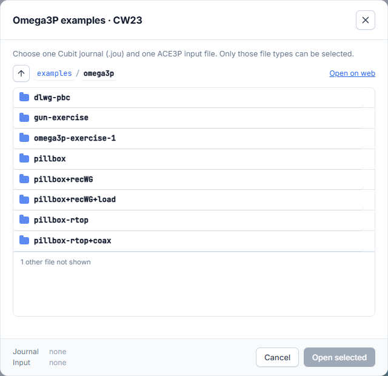
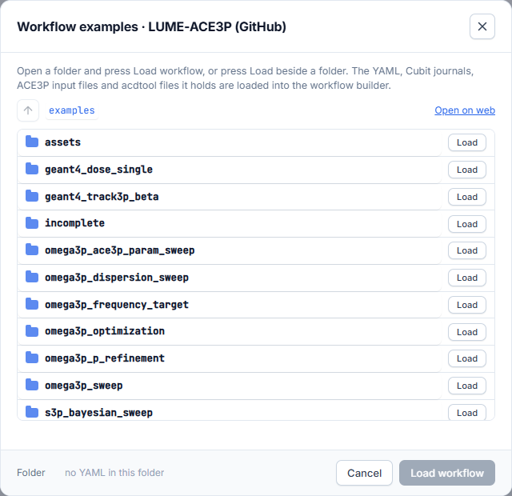

# Examples

The **Examples** button next to the solver name loads ready-made examples. It
needs an internet connection.

## Solver examples (Simulation Setup)

On **Simulation Setup**, Examples browses the CW23 ACE3P workshop examples for
the current solver.

1. Open a folder, for example **pillbox+recWG**.
2. Select one Cubit journal (`.jou`) and one input file (`.omega3p`, `.s3p`, …).
   Only these file types can be selected. The footer shows what is selected.
3. Press **Open selected**.

The input file fills the form and the journal becomes the mesh, meshed and
drawn in the Mesh Viewer. **Open on web** opens the folder in your browser.

## Workflow examples (Workflow Orchestration)

On **Workflow Orchestration**, Examples browses the `examples` folder of the
[LUME-ACE3P repository](https://github.com/slaclab/lume-ace3p).

Select a folder and press **Open selected**. Loading an example **replaces the
current workflow**:

- The YAML fills the builder.
- The journal it names becomes the mesh.
- Every input file the YAML refers to is added to the workflow file library
  under its own name.

An example that uses a feature the builder has no form for (for example a
Geant4 step) is loaded as hand-edited YAML. It is submitted exactly as written.
