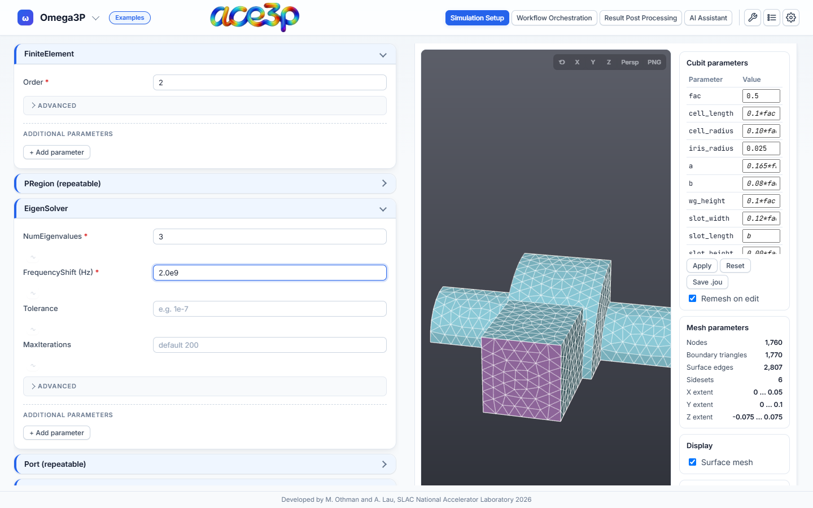
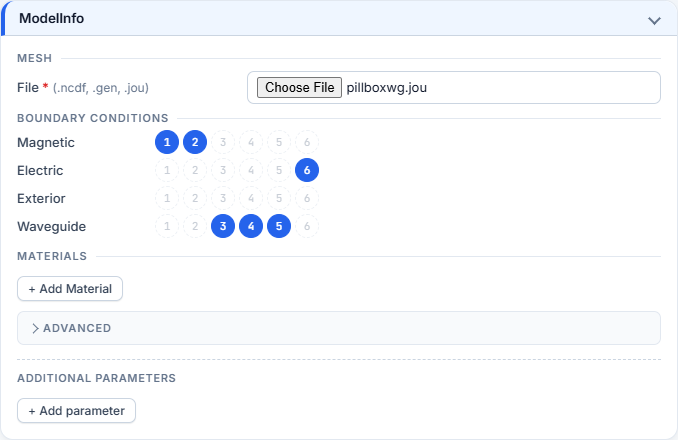
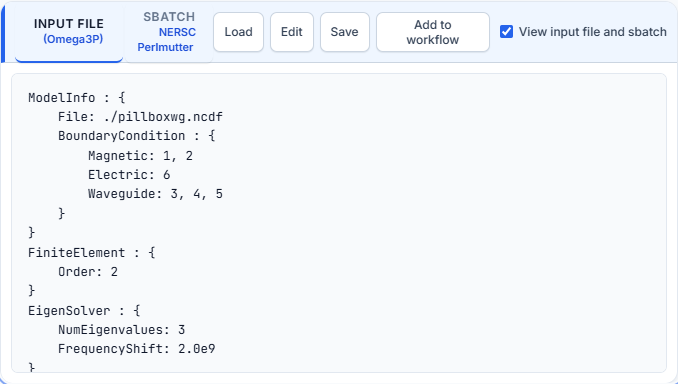

# Fill in the input file

The form on the left builds the ACE3P input file. The preview on the right shows
the result and updates on every change.

## Containers and fields

Each box in the form is one container of the input file (`ModelInfo`,
`EigenSolver`, …). Click its heading to open or close it.

- Type values exactly as ACE3P expects them. Numbers can be written as
  `2.0e9`, `2e9` or `2000000000`.
- A field left empty is not written. The solver uses its default, shown as
  grey placeholder text (for example `default 200`).
- A red **\*** marks a required field. A red dot on the container heading means
  a required field inside is empty.
- Hover over a field label to read its tooltip.

## Boundary conditions

Once a mesh is selected, each boundary-condition row shows the mesh's sideset
numbers as circles.

- Click a circle to assign the sideset; click it again to remove it.
- A sideset belongs to one boundary type. Its circle is greyed out in every
  other row.
- A sideset number that the input file uses but the mesh does not contain is
  shown with a dashed outline. Click it to remove it.
- Without a mesh, the rows are plain text fields. Type comma-separated sideset
  numbers, for example `3, 4`.

## Additional parameters and containers

The form covers the documented parameters of each solver. To write any other
parameter:

1. Press **+ Add parameter** at the bottom of the container.
2. Enter the parameter name and value.

To add a whole container the form does not have, open **Additional
containers** at the end of the form and add a parameter with a path, for
example `NewBlock/Inner`. Use `[2]` to address the second block of a repeated
container, for example `ModelInfo/Material[2]`.

When you load an input file, every parameter the form has no field for is kept
as an additional parameter, so the file is written back without loss.

## Preview toolbar

Tick **View input file and sbatch** to show the text. Choose the
**INPUT FILE** or **SBATCH** tab.

| Button | Effect |
|---|---|
| **Load** | Opens an input file from your computer. The extension picks the solver (`.omega3p` → Omega3P). The form is filled from the file. |
| **Edit** | Makes the text editable. The form follows your edits. Press **Done** to finish. |
| **Save** | Downloads the file as `input.<solver>`. |
| **Add to workflow** | Adds the current input file to the workflow file library for [Workflow Orchestration](../workflow/index.md). |

On the **SBATCH** tab, **Edit** and **Save** do the same for the batch script.

!!! note "File name"
    The input file is always `input.<solver>`. A loaded file is renamed to that
    name, whatever it was called on disk. The batch script refers to this name.

## Comments in loaded files

Comments in a loaded file are kept while the text is unchanged. Once you edit a
field, the file is regenerated from the form and comments are dropped. Keep a
copy of a heavily commented file.

## Reset

**View → Reset form** clears the Omega3P or S3P form and the selected mesh.
**View → Undo reset** brings it back.
