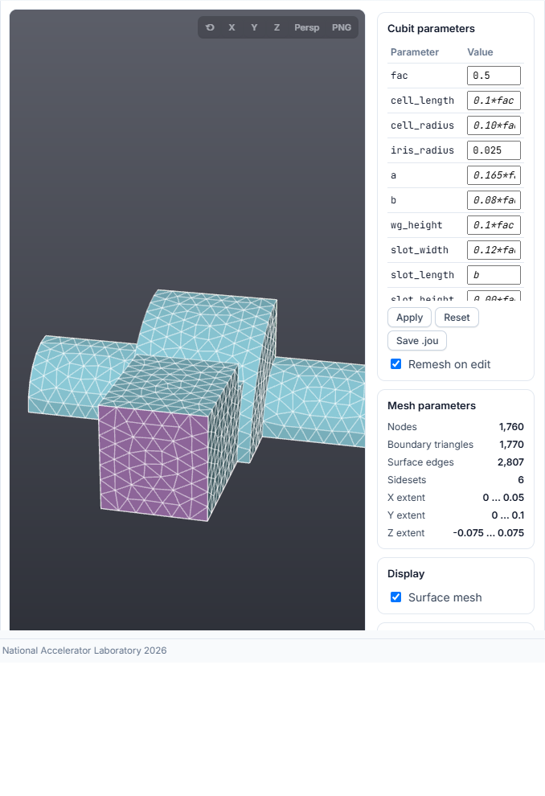
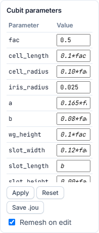

# Mesh and Cubit parameters

## Mesh formats

Choose the mesh in **ModelInfo → File** (TEM3P and Gun3P have the same picker
in their problem containers). Three formats are accepted:

| Format | What happens on selection | What the batch script does |
|---|---|---|
| `.ncdf` | Drawn in the Mesh Viewer directly. | Nothing; the solver reads it. |
| `.gen` (Genesis) | Converted to `.ncdf` on your computer and drawn. | `acdtool meshconvert` converts it on the cluster. |
| `.jou` (Cubit journal) | Meshed with Cubit, converted and drawn. | Runs Cubit on the journal, then `acdtool meshconvert`. |

`ModelInfo → File` is filled in automatically with the `.ncdf` name the solver
will read. With a `.jou`, the name comes from the journal's own `export genesis`
line.

The mesh you see on screen and the mesh the job runs on are produced
separately: the viewer meshes on the machine running the app, the job meshes
again on the compute node. Both use the same journal.

## Requirements for a journal

- It must export a Genesis file, for example:

    ```text
    export genesis "pillboxwg.gen" overwrite
    ```

    A journal without an `export genesis` (or `export mesh`) line produces no
    mesh, and the Messages window says so.

- It must define the sidesets the solver needs (`sideset <n> surface ...`).
  The sideset numbers become the boundary-condition circles in the form.
- It must run without user input. The app runs Cubit with
  `-nographics -batch -nojournal`.

## Mesh Viewer



| Action | Control |
|---|---|
| Rotate | Left-drag |
| Pan | Right-drag, middle-drag, or ++shift++ + left-drag |
| Zoom | Mouse wheel (click inside the viewer first) |
| Reset the view | Double-click, or the ↺ button |
| Look along an axis | **X**, **Y**, **Z** (press again for the opposite side) |
| Perspective / parallel projection | **Persp** |
| Save an image | **PNG** |
| Identify a surface | Hover: the sideset id and its boundary condition are shown |

The side column has three panels:

- **Mesh parameters:** node count, boundary triangles, surface edges, number
  of sidesets and the X/Y/Z extent of the model.
- **Display → Surface mesh:** shows or hides the element edges. It is disabled
  for very large meshes, with the reason in its tooltip.
- **Sidesets:** one checkbox per sideset, with its colour. **All** and
  **None** toggle every sideset. A hidden sideset stays as a faint outline.

The **Mesh Viewer** heading folds the card away. The arrow at its right end
does the same.

## Cubit parameters

When the mesh is a `.jou`, the **Cubit parameters** panel lists every
`#{name = value}` variable declared in the journal.



To change the geometry:

1. Click a value and type the new one. Expressions such as `0.1*fac` are kept
   as written.
2. Press ++enter++ or click outside the field.
3. With **Remesh on edit** ticked, the journal is rewritten with the new value,
   meshed again and redrawn.

| Button | Effect |
|---|---|
| **Apply** | Remeshes with the values typed so far. Use it when **Remesh on edit** is off. |
| **Reset** | Restores the values of the journal you originally selected. |
| **Save .jou** | Downloads the journal with the current values. |

The edited journal is the one submitted: Run Simulation and Workflow
Orchestration upload it with the new values. A value typed but not yet
committed is applied automatically before submission.

## Cubit and ParaView buttons

The Cubit logo opens the Cubit application. The ParaView logo opens ParaView.
Neither is needed to mesh or view a journal.

- **On your computer:** the app searches the usual install folders and `PATH`.
  If it cannot find the program, it asks for the path to `claro.exe` (Cubit)
  or `paraview.exe` and remembers it.
- **On Perlmutter or S3DF:** the program comes from the ACE3P environment and
  opens on your ThinLinc or NoMachine desktop.

A button is disabled for 10 seconds after a successful launch so a double click
does not start two copies.

## Cubit not found

If the Messages window reports that Cubit was not found:

1. Install Cubit, or
2. set the environment variable `ACE3P_CUBIT_EXE` to the full path of the Cubit
   executable and restart the app, or
3. select a `.gen` or `.ncdf` instead, which needs no Cubit on your computer.

The job itself does not depend on your local Cubit: the batch script meshes the
journal on the cluster with the site installation.
