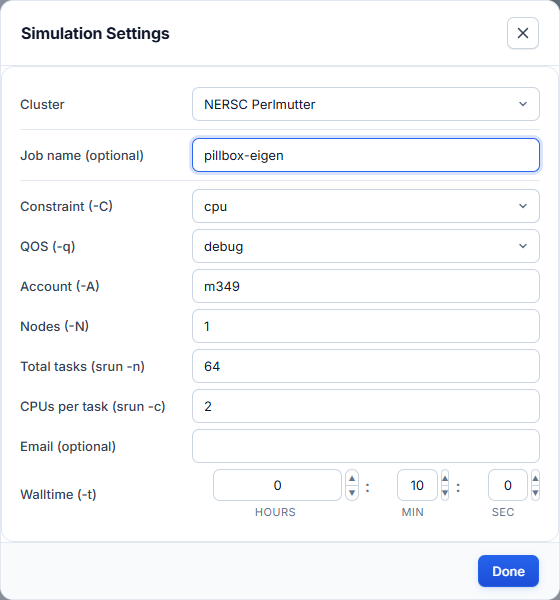

# Simulation Settings (sbatch)

The batch script is generated from the solver, the mesh and the values in
**Simulation Settings**. Open the dialog with the **Simulation Settings**
button next to Run Simulation. The same dialog is in the Workflow
Orchestration toolbar; one set of values serves both.



First pick where to run in **Run on**: NERSC Perlmutter, S3DF, or **Local
(this PC)** on a Windows workstation (see [Local simulation on
Windows](#local-simulation-on-windows)). The fields below change with it.

**Job name (optional)** labels the job on the Jobs dashboard. It is shared by
Simulation Setup and Workflow Orchestration and used by the next
**Run Simulation** in either.

## NERSC Perlmutter

| Field | Slurm option | Notes |
|---|---|---|
| Constraint | `-C` | `cpu` or `gpu`. Picks the node type and the matching ACE3P build. |
| QOS | `-q` | `debug` (short tests), `regular`, `premium`, `preempt`. |
| Account | `-A` | Your NERSC project, for example `m1234`. Replace the default with a project you belong to. |
| Nodes | `-N` | Number of nodes. |
| Total tasks | `srun -n` | MPI ranks across all nodes. |
| CPUs per task | `srun -c` | Logical CPUs per rank. |
| Email | `--mail-user` | Optional. Adds `--mail-type=END,FAIL`: you get a mail when the job ends or fails. |
| Walltime | `-t` | Hours, minutes, seconds. |

## S3DF

| Field | Slurm option | Notes |
|---|---|---|
| Account | `--account` | `facility:group`, for example `rfar:regular`. |
| Partition | `--partition` | `milano`, `roma`, `ampere`, `ada`, `turing`. |
| Nodes | `--nodes` | |
| Tasks per node | `--ntasks-per-node` | MPI ranks per node. |
| CPUs per task | `--cpus-per-task` | |
| Email | `--mail-user` | Optional. Adds `--mail-type=END,FAIL`: you get a mail when the job ends or fails. |
| Walltime | `--time` | |

## Local simulation on Windows

**Local (this PC)** runs the solvers on the Windows workstation the app runs
on, with no cluster, sign-in or queue.

**Requirements**

- The Windows build of the app. The option is not offered on Linux or macOS.
- A standalone ACE3P installation: **ACE3P for Windows**, installed with its
  own installer (default folder `%LOCALAPPDATA%\Programs\ACE3P\bin`, added to
  `PATH`). Its launchers (`omega3p.exe`, `s3p.exe`, `t3p.exe`,
  `acdtool.exe`, `ace3p.exe`, ...) run the Linux solvers under MPI in a small
  WSL runtime. The GUI does not include ACE3P itself.
- Coreform Cubit on the same PC, only if the mesh is a `.jou` journal. A
  `.gen` or `.ncdf` mesh needs no Cubit.

**Choosing it**

1. In Simulation Settings set **Run on** to **Local (this PC)** (or pick it in
   the **Sbatch destination** menu).
2. The first time, the **Locate omega3p.exe** dialog opens. It is filled in
   when ACE3P is on `PATH` or in the default folder, and shows the cores and
   memory ACE3P can use, for example *Found on PATH · 4 cores · 7.7 GB*.
   Otherwise press **Browse…** and choose `omega3p.exe` (or its `bin`
   folder). Press **Use this ACE3P**.
3. Simulation Settings then shows the location in the **ACE3P for Windows**
   row. **Change…** points the app at another installation.

| Field | Launcher option | Notes |
|---|---|---|
| Processes | `-n` | Number of MPI processes. Use at most the number of physical cores. |

There is no account, queue, node count or walltime.

**Folders and runs**

- While Local is chosen, **Load simulation**, **Save** and **Save as…** use
  folders on this PC. The default is `Documents\ACE3P-runs` (the
  **Scratch** button in the folder picker). Run Simulation needs a folder on
  this PC when Local is chosen, and a cluster folder otherwise.
- **Run Simulation** writes the input file, the mesh and `run-local.cmd` to
  the folder and starts the script in the background. The job keeps running
  if the GUI is closed.
- Logs are `<solver>-<job>.out` and `<solver>-<job>.err` in the folder, as on
  the clusters. The Jobs dashboard shows the state and the logs, lists and
  downloads results, and **Cancel** stops the solver (`ace3p cancel`).
- Result Post Processing lists **This PC** as a source, so the Data Explorer,
  Field Viewer and Workflow Sweeps work on local runs.

**Workflow studies**

Workflow Orchestration runs locally with the LUME-ACE3P bundled in the app;
no Python environment is needed. Only the **Single Run** and **Parameter
Sweep** modes run locally. **Optimization** and **GP Surrogate Model** need
Xopt and PyTorch, which are not bundled; run those on a cluster.

**Sizing**

- Every MPI process holds its own part of the problem, and ACE3P can use only
  the memory of its WSL runtime (shown in the Locate dialog), not all of the
  PC's memory. Memory grows with the mesh size and `FiniteElement → Order`.
- Hyperthreads do not speed up the solvers; keep **Processes** at or below
  the physical core count.
- Example: on a 4-core workstation with 7.7 GB available to ACE3P, Omega3P
  problems above about 400,000 unknowns ran out of memory. Larger problems
  belong on Perlmutter or S3DF.

## The generated script

=== "NERSC"

    ```bash
    #!/bin/bash -l
    #SBATCH -C cpu        # constraint: cpu or gpu
    #SBATCH -q debug      # QOS: debug | regular | premium | preempt
    #SBATCH -A m1234      # NERSC project repo
    #SBATCH -N 1          # nodes
    #SBATCH -t 00:10:00   # walltime HH:MM:SS
    #SBATCH -J omega3p
    #SBATCH -e %x-%j.err
    #SBATCH -o %x-%j.out

    export DIR=$PWD
    source /global/cfs/cdirs/ace3p/perlmutter/CPU/perlmutter-ace3p-spack.sh

    cd $DIR

    # generate mesh from Cubit journal, then convert to .ncdf
    CUBIT="${CUBIT:-$(type -P cubit || echo /global/cfs/cdirs/ace3p/perlmutter/CPU/cubit)}"
    "$CUBIT" -nogui pillboxwg.jou
    acdtool meshconvert pillboxwg.gen

    srun -n 64 -c 2 --cpu-bind=cores /global/cfs/cdirs/ace3p/perlmutter/CPU/omega3p input.omega3p
    ```

=== "S3DF"

    ```bash
    #!/bin/bash
    #SBATCH --account=rfar:regular  # facility:group
    #SBATCH --partition=milano      # milano | roma | ampere | ada | turing
    #SBATCH --job-name=omega3p
    #SBATCH --nodes=1
    #SBATCH --ntasks-per-node=32
    #SBATCH --cpus-per-task=1
    #SBATCH --time=02:00:00
    #SBATCH --output=%x-%j.out
    #SBATCH --error=%x-%j.err

    echo $SLURM_JOB_NODELIST

    source /sdf/group/rfar/ace3p/ace3p.sh
    module load openmpi/v4.1.6-spack
    export OMPI_MCA_sharedfp=^lockedfile

    export DIR=$PWD
    cd $DIR

    # generate mesh from Cubit journal, then convert to .ncdf
    CUBIT="${CUBIT:-$(type -P cubit || echo /sdf/group/rfar/software/cubit)}"
    "$CUBIT" -nogui pillboxwg.jou
    acdtool meshconvert pillboxwg.gen

    srun -n 32 --cpu-bind=cores /sdf/group/rfar/ace3p/bin/omega3p input.omega3p
    ```

=== "Local (this PC)"

    ```bat
    @echo off
    rem omega3p on this PC with ACE3P for Windows, 4 MPI process(es).
    rem Started by the ACE3P GUI; output goes to <module>-<job>.out / .err.
    cd /d "%~dp0"
    if not defined ACE3P_JOB_ID set "ACE3P_JOB_ID=run-%RANDOM%"

    rem generate the mesh from the Cubit journal, then convert it to .ncdf
    if not defined ACE3P_CUBIT_EXE set "ACE3P_CUBIT_EXE=cubit"
    "%ACE3P_CUBIT_EXE%" -nographics -batch -nojournal -noecho -information off pillboxwg.jou
    if errorlevel 1 exit /b %errorlevel%
    acdtool meshconvert pillboxwg.gen
    if errorlevel 1 exit /b %errorlevel%

    omega3p input.omega3p -n 4 --job-id %ACE3P_JOB_ID%
    ```

    The local script is `run-local.cmd`, a Windows batch file. It can also be
    run by hand from a command prompt in the run folder.

What the script does, in order:

1. Requests the resources from Simulation Settings.
2. Names the job after the solver (`-J omega3p`). Logs are written to
   `<solver>-<jobid>.out` and `<solver>-<jobid>.err` in the run directory.
3. Loads the ACE3P environment of that cluster.
4. With a `.jou` mesh: runs Cubit, then `acdtool meshconvert`. With a `.gen`:
   runs only `acdtool meshconvert`. With a `.ncdf`: nothing.
5. Runs the solver with `srun` on `input.<solver>`.

## Sbatch destination

The **Sbatch destination** menu below the Mesh Viewer switches the script
between NERSC, S3DF and Local (this PC) without opening the dialog. The choice is remembered.
When the app runs on a cluster, the script is generated for that cluster.

## Sizing a job

- **Walltime** is a hard limit. Slurm kills the job when it is reached, and
  the solver writes no results. Ask for more time than you expect.
- The `debug` QOS on Perlmutter is limited to 30 minutes. Use it to check that
  a new setup starts correctly, then resubmit with `regular`.
- Memory grows with the number of unknowns, which grows with the mesh size and
  `FiniteElement → Order`. If a job fails with an out-of-memory error, add nodes
  and keep the tasks per node the same.

## Editing the script by hand

On the **SBATCH** tab press **Edit** to change the text directly, for example to
add `#SBATCH` options the dialog does not offer, then press **Done**. Changing
Simulation Settings, the mesh or the solver afterwards regenerates the script
and discards the hand edits, so make them last.
