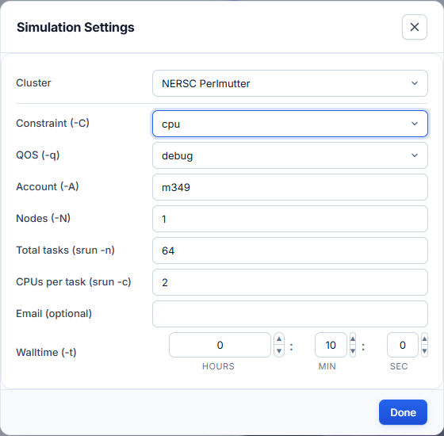

# Simulation Settings (sbatch)

The batch script is generated from the solver, the mesh and the values in
**Simulation Settings**. Open the dialog with the **Simulation Settings**
button next to Run Simulation. The same dialog is in the Workflow
Orchestration toolbar; one set of values serves both.



First pick the **Cluster**. The fields below change with it.

## NERSC Perlmutter

| Field | Slurm option | Notes |
|---|---|---|
| Constraint | `-C` | `cpu` or `gpu`. Picks the node type and the matching ACE3P build. |
| QOS | `-q` | `debug` (short tests), `regular`, `premium`, `preempt`. |
| Account | `-A` | Your NERSC project, for example `m1234`. Replace the default with a project you belong to. |
| Nodes | `-N` | Number of nodes. |
| Total tasks | `srun -n` | MPI ranks across all nodes. |
| CPUs per task | `srun -c` | Logical CPUs per rank. |
| Email | `--mail-user` | Optional. Adds `--mail-type=END,FAIL`: you get a mail when the job ends or fails. |
| Walltime | `-t` | Hours, minutes, seconds. |

## S3DF

| Field | Slurm option | Notes |
|---|---|---|
| Account | `--account` | `facility:group`, for example `rfar:regular`. |
| Partition | `--partition` | `milano`, `roma`, `ampere`, `ada`, `turing`. |
| Nodes | `--nodes` | |
| Tasks per node | `--ntasks-per-node` | MPI ranks per node. |
| CPUs per task | `--cpus-per-task` | |
| Email | `--mail-user` | Optional. Adds `--mail-type=END,FAIL`: you get a mail when the job ends or fails. |
| Walltime | `--time` | |

## The generated script

=== "NERSC"

    ```bash
    #!/bin/bash -l
    #SBATCH -C cpu        # constraint: cpu or gpu
    #SBATCH -q debug      # QOS: debug | regular | premium | preempt
    #SBATCH -A m1234      # NERSC project repo
    #SBATCH -N 1          # nodes
    #SBATCH -t 00:10:00   # walltime HH:MM:SS
    #SBATCH -J omega3p
    #SBATCH -e %x-%j.err
    #SBATCH -o %x-%j.out

    export DIR=$PWD
    source /global/cfs/cdirs/ace3p/perlmutter/CPU/perlmutter-ace3p-spack.sh

    cd $DIR

    # generate mesh from Cubit journal, then convert to .ncdf
    CUBIT="${CUBIT:-$(type -P cubit || echo /global/cfs/cdirs/ace3p/perlmutter/CPU/cubit)}"
    "$CUBIT" -nogui pillboxwg.jou
    acdtool meshconvert pillboxwg.gen

    srun -n 64 -c 2 --cpu-bind=cores /global/cfs/cdirs/ace3p/perlmutter/CPU/omega3p input.omega3p
    ```

=== "S3DF"

    ```bash
    #!/bin/bash
    #SBATCH --account=rfar:regular  # facility:group
    #SBATCH --partition=milano      # milano | roma | ampere | ada | turing
    #SBATCH --job-name=omega3p
    #SBATCH --nodes=1
    #SBATCH --ntasks-per-node=32
    #SBATCH --cpus-per-task=1
    #SBATCH --time=02:00:00
    #SBATCH --output=%x-%j.out
    #SBATCH --error=%x-%j.err

    echo $SLURM_JOB_NODELIST

    source /sdf/group/rfar/ace3p/ace3p.sh
    module load openmpi/v4.1.6-spack
    export OMPI_MCA_sharedfp=^lockedfile

    export DIR=$PWD
    cd $DIR

    # generate mesh from Cubit journal, then convert to .ncdf
    CUBIT="${CUBIT:-$(type -P cubit || echo /sdf/group/rfar/software/cubit)}"
    "$CUBIT" -nogui pillboxwg.jou
    acdtool meshconvert pillboxwg.gen

    srun -n 32 --cpu-bind=cores /sdf/group/rfar/ace3p/bin/omega3p input.omega3p
    ```

What the script does, in order:

1. Requests the resources from Simulation Settings.
2. Names the job after the solver (`-J omega3p`). Logs are written to
   `<solver>-<jobid>.out` and `<solver>-<jobid>.err` in the run directory.
3. Loads the ACE3P environment of that cluster.
4. With a `.jou` mesh: runs Cubit, then `acdtool meshconvert`. With a `.gen`:
   runs only `acdtool meshconvert`. With a `.ncdf`: nothing.
5. Runs the solver with `srun` on `input.<solver>`.

## Sbatch destination

The **Sbatch destination** menu below the Mesh Viewer switches the script
between NERSC and S3DF without opening the dialog. The choice is remembered.
When the app runs on a cluster, the script is generated for that cluster.

## Sizing a job

- **Walltime** is a hard limit. Slurm kills the job when it is reached, and
  the solver writes no results. Ask for more time than you expect.
- The `debug` QOS on Perlmutter is limited to 30 minutes. Use it to check that
  a new setup starts correctly, then resubmit with `regular`.
- Memory grows with the number of unknowns, which grows with the mesh size and
  `FiniteElement → Order`. If a job fails with an out-of-memory error, add nodes
  and keep the tasks per node the same.

## Editing the script by hand

On the **SBATCH** tab press **Edit** to change the text directly, for example to
add `#SBATCH` options the dialog does not offer, then press **Done**. Changing
Simulation Settings, the mesh or the solver afterwards regenerates the script
and discards the hand edits, so make them last. For a fully custom script, use
**Upload custom files** in the Run Simulation dialog. See
[Run a simulation](../running-jobs/run-simulation.md#custom-files).
