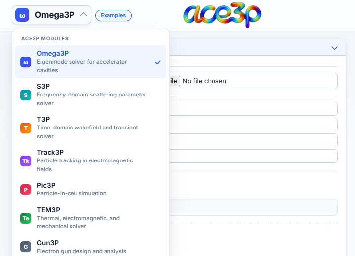
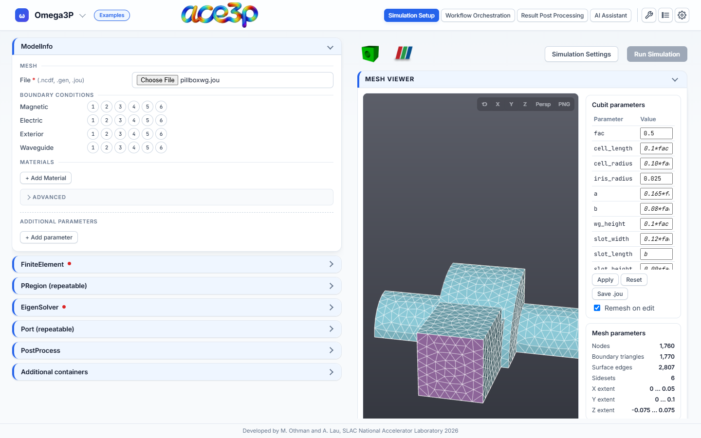
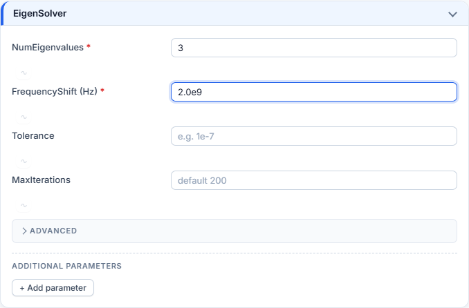
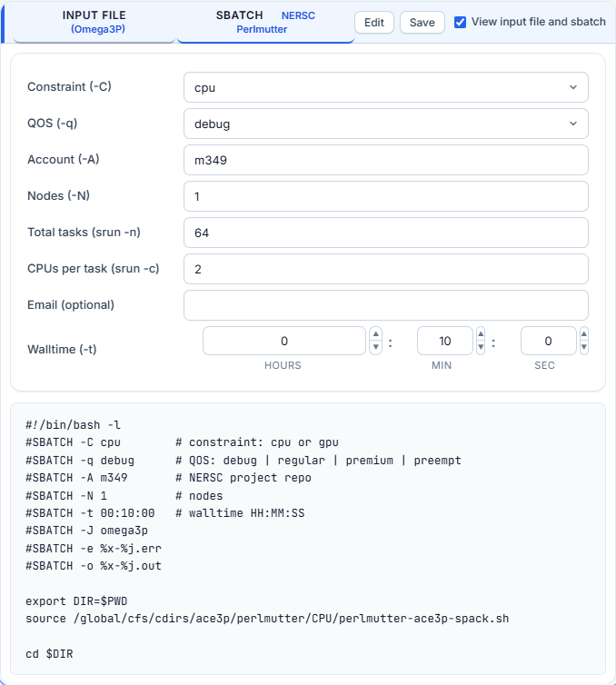
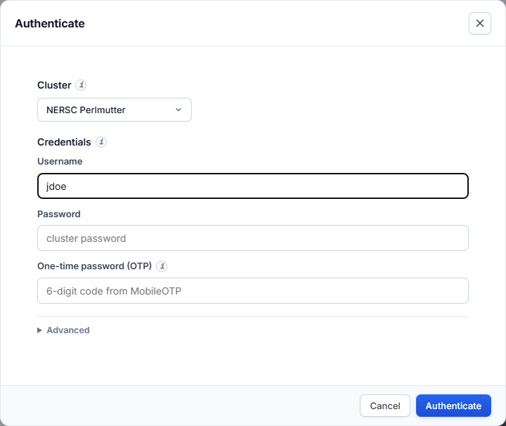
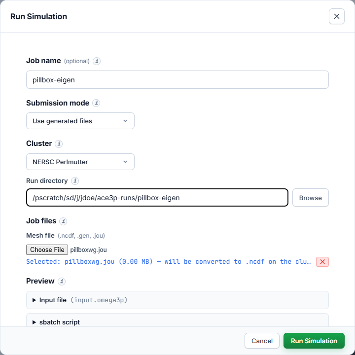
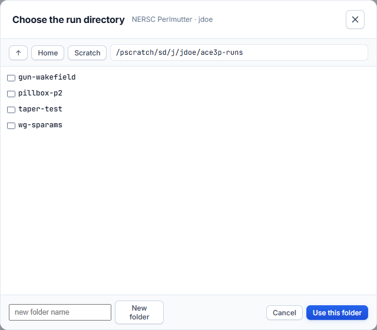
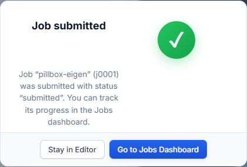
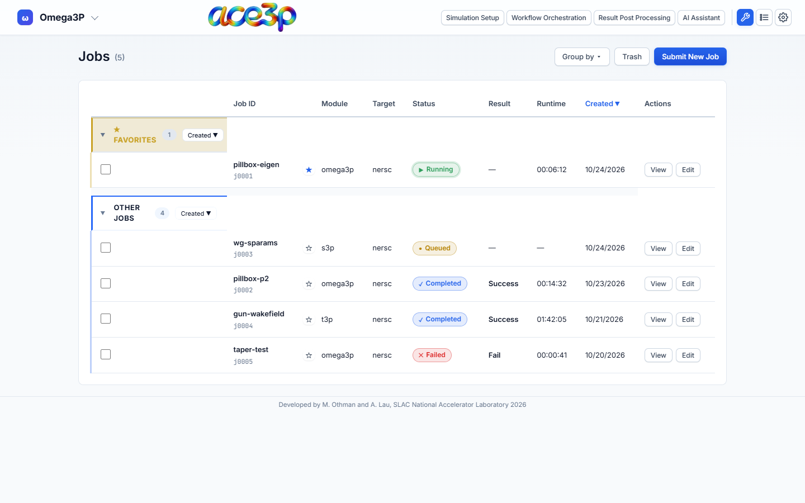
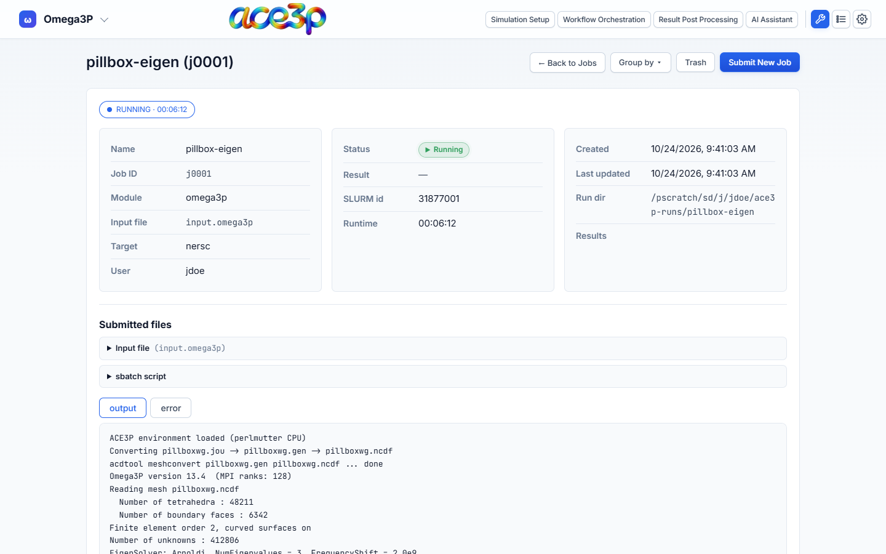

# Your first Omega3P job

This tutorial takes one job from an empty form to results on disk: an Omega3P
eigenmode calculation of a pillbox cavity with a waveguide, meshed from a Cubit
journal and run on NERSC Perlmutter. The same steps apply to S3DF and to the
other solvers.

**You need:**

- ACE3P GUI running ([Install and launch](../getting-started/install.md)).
- A Cubit journal (`.jou`) that exports a Genesis mesh, or a ready mesh
  (`.gen` or `.ncdf`). This tutorial uses `pillboxwg.jou`.
- A NERSC account with an allocation, and the MobileOTP app.
- To see the mesh before you submit: Cubit installed on your computer, or the
  app running on Perlmutter or S3DF. Without Cubit you can still submit; the
  cluster meshes the journal.

## Step 1: Pick the solver

Click the solver name at the top left and choose **Omega3P**.



The left pane now shows the Omega3P containers: `ModelInfo`, `FiniteElement`,
`PRegion`, `EigenSolver`, `Port` and `PostProcess`. Boxes with a red dot hold
required fields that are still empty.

## Step 2: Choose the mesh

1. Open the **ModelInfo** box.
2. Next to **File**, press **Choose File** and select `pillboxwg.jou`.

The app runs Cubit on the journal in batch mode, converts the exported `.gen`
to `.ncdf`, and draws the mesh in the **Mesh Viewer**. A small journal takes
seconds; a large one can take minutes. Progress appears in the Messages window:

```text
Mesh viewer: Meshing pillboxwg.jou with Cubit... this can take a few minutes.
Meshed pillboxwg.jou → pillboxwg.ncdf in 1.28s.
```



`ModelInfo → File` is filled in for you with the `.ncdf` name the solver will
read (`./pillboxwg.ncdf`). The **Cubit parameters** table lists every
`#{name = value}` variable in the journal. The **Sidesets** list shows the
boundary surfaces the journal defined.

!!! tip "Check the sidesets"
    Hover over the mesh to see which sideset is under the pointer. Untick a
    sideset in the list to hide it and see the surfaces behind it. Use the
    **X**, **Y**, **Z** buttons for axis views and the reset button to fit the
    model again.

If the Messages window reports that Cubit was not found, see
[Mesh and Cubit parameters](../simulation-setup/mesh.md#cubit-not-found).
You can still continue: the batch script meshes the journal on the cluster.

## Step 3: Assign boundary conditions

Under **BOUNDARY CONDITIONS**, each boundary type shows the mesh's sideset
numbers as circles. Click a circle to assign that sideset to the boundary type.
A sideset can belong to one boundary type only; once used, its circle is
greyed out in the other rows.


For this model:

| Boundary type | Sidesets |
|---|---|
| Magnetic | 1, 2 |
| Electric | 6 |
| Waveguide | 3, 4, 5 |

Use the sideset definitions in your own journal (`sideset <n> surface ...`) to
decide which sideset gets which condition. A sideset left unassigned is not
written to the input file.

## Step 4: Set the solver parameters

1. Open **FiniteElement** and set **Order** to `2`.
2. Open **EigenSolver** and set:
    - **NumEigenvalues**: `3` — the number of modes to compute.
    - **FrequencyShift (Hz)**: `2.0e9` — Omega3P finds the modes closest to
      this frequency. Set it just below the lowest mode you want.
3. Leave the other fields empty to use the solver defaults shown as grey
   placeholders.



The red dots disappear once every required field is filled.

## Step 5: Review the input file

Tick **View input file and sbatch** in the preview toolbar and select the
**INPUT FILE** tab. The file updates on every keystroke.


```text
ModelInfo : {
    File: ./pillboxwg.ncdf
    BoundaryCondition : {
        Magnetic: 1, 2
        Electric: 6
        Waveguide: 3, 4, 5
    }
}
FiniteElement : {
    Order: 2
}
EigenSolver : {
    NumEigenvalues: 3
    FrequencyShift: 2.0e9
}
```

The file is always named `input.omega3p`. **Save** downloads it. **Edit** lets
you change the text directly; the form follows your edits.

## Step 6: Set the Slurm resources

Press **Simulation Settings** (next to Run Simulation).


1. **Cluster:** NERSC Perlmutter.
2. **Constraint:** `cpu`.
3. **QOS:** `debug` for a test run (30 minutes maximum), `regular` for
   production.
4. **Account:** your NERSC project, for example `m1234`. The default shown is
   only a placeholder: replace it with a project you are a member of.
5. **Nodes**, **Total tasks** and **CPUs per task:** the MPI layout.
   `1` node, `64` tasks, `2` CPUs per task fills one Perlmutter CPU node.
6. **Walltime:** the maximum run time. The job is killed when it is reached.
7. Press **Done**.

## Step 7: Review the batch script

Select the **SBATCH** tab in the preview.



```bash
#!/bin/bash -l
#SBATCH -C cpu        # constraint: cpu or gpu
#SBATCH -q debug      # QOS: debug | regular | premium | preempt
#SBATCH -A m1234      # NERSC project repo
#SBATCH -N 1          # nodes
#SBATCH -t 00:10:00   # walltime HH:MM:SS
#SBATCH -J omega3p
#SBATCH -e %x-%j.err
#SBATCH -o %x-%j.out

export DIR=$PWD
source /global/cfs/cdirs/ace3p/perlmutter/CPU/perlmutter-ace3p-spack.sh

cd $DIR

# generate mesh from Cubit journal, then convert to .ncdf
CUBIT="${CUBIT:-$(type -P cubit || echo /global/cfs/cdirs/ace3p/perlmutter/CPU/cubit)}"
"$CUBIT" -nogui pillboxwg.jou
acdtool meshconvert pillboxwg.gen

srun -n 64 -c 2 --cpu-bind=cores /global/cfs/cdirs/ace3p/perlmutter/CPU/omega3p input.omega3p
```

The script loads the ACE3P environment, meshes the journal with the site's
Cubit, converts it with `acdtool`, and runs Omega3P with `srun`. Logs go to
`omega3p-<jobid>.out` and `omega3p-<jobid>.err`.

## Step 8: Sign in

Press **Run Simulation**. The button is green when the mesh, input file and
sbatch script are ready; its tooltip names anything still missing.

If NERSC is not signed in yet, the **Authenticate** dialog opens:



Enter your user name, password and the MobileOTP code, then press
**Authenticate**. The Run Simulation dialog opens next. See
[Sign in to a cluster](../getting-started/sign-in.md) for S3DF.

## Step 9: Submit



1. **Job name:** `pillbox-eigen`. It labels the job in the dashboard.
2. **Submission mode:** **Use generated files**.
3. **Cluster:** NERSC Perlmutter.
4. **Run directory:** the folder on the cluster where the job runs. Use
   scratch, for example `/pscratch/sd/j/jdoe/ace3p-runs/pillbox-eigen`.
   Press **Browse** to pick or create a folder.

    

5. **Mesh file:** already set to `pillboxwg.jou`.
6. Open **Preview** to check the input file and sbatch script one last time.
7. Press **Run Simulation**.

The progress bar shows the upload of the mesh, the input file and the script,
then `sbatch`. On success:



!!! warning "Run directory rules"
    The files go into the run directory exactly as typed. No subfolder is
    added. A run directory that still holds a submitted, queued or running job
    is refused: use a new folder for each concurrent job.

## Step 10: Monitor the job

Press **Go to Jobs Dashboard**.



The status follows Slurm: **Submitted → Queued → Running → Completed** (or
**Failed** / **Cancelled**). Press **View** on the job.



The detail page polls Slurm for the status and runtime and shows the end of the
**output** and **error** logs. Switch logs with the **output** / **error**
buttons.

## Step 11: Get the results

When the job is **Completed**, the **Results** row of the detail page offers:


- **Download results** — the whole run directory as one `.tar.gz`.
- **Post-Process Viewer** — draws the computed modes on the mesh surface, in
  the browser.

For R/Q, kick factors, field maps and plots of result tables, open
**Result Post Processing**. It starts on this job's run directory. See
[Result Post Processing](../post-processing/index.md).

## Checklist for a correct job

- [x] The right solver is selected in the header.
- [x] A mesh file is chosen and the Mesh Viewer shows the expected geometry.
- [x] Every sideset that needs a boundary condition is assigned to exactly one
      type.
- [x] No container shows a red dot.
- [x] The input file preview contains the values you intended.
- [x] Simulation Settings: correct cluster, **your** account, a QOS that fits
      the walltime.
- [x] The run directory is on scratch and not used by a running job.
