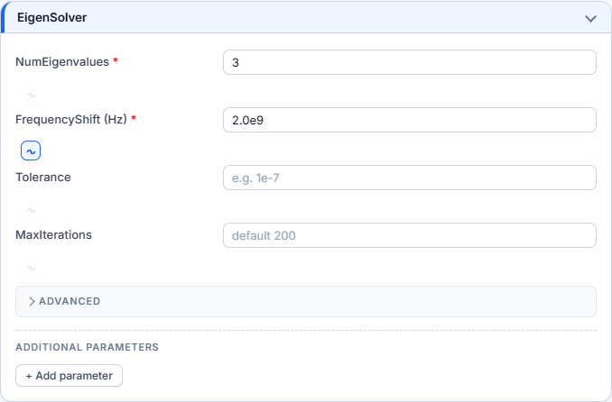
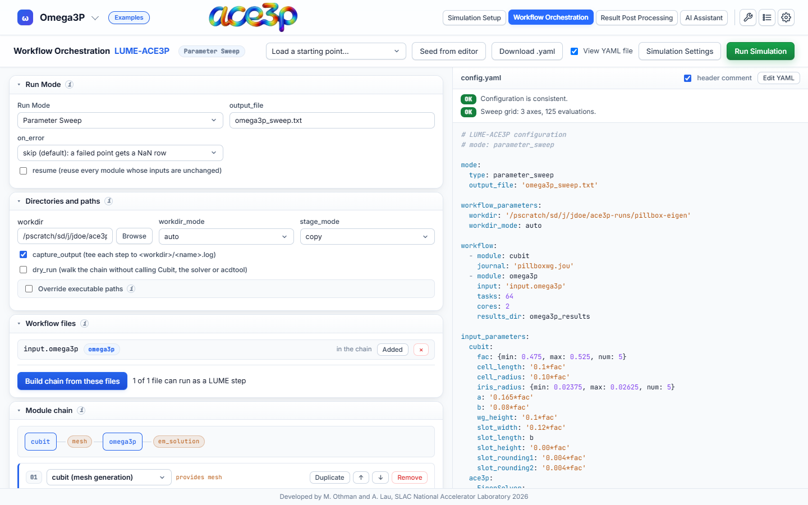

# Workflow Orchestration

**Workflow Orchestration** builds a [LUME-ACE3P](https://github.com/slaclab/lume-ace3p)
study. A study runs a chain of steps — for example Cubit → Omega3P — many
times with different input values, collects chosen results into one table, and
optionally lets an optimizer pick the next input values.

The builder writes the study's YAML configuration. You submit it with the same
**Run Simulation** dialog as a single job; it then runs as one Slurm job that
launches every evaluation inside its allocation.


## Run modes

| Run mode | What it does | Needs |
|---|---|---|
| **Single Run** | Evaluates the chain once. | A chain. |
| **Parameter Sweep** | Evaluates the chain on a grid. Every input given as a list or as `min, max, num` is one axis; all axes are combined. | At least one swept input. |
| **Optimization** | Hands the chain to Xopt, which chooses input values to minimize or maximize an objective. | Optimization problem and optimizer settings. |
| **GP Surrogate Model** | Explores first, trains a Gaussian Process, then samples it on a grid. | Optimization problem, optimizer settings and a posterior sweep grid. |

The number of evaluations in a sweep is the product of the axis lengths: three
axes of 5 values are 125 evaluations.

## Build a parameter sweep step by step

### 1. Prepare the solver input in Simulation Setup

1. Set up the solver as for a single job: mesh, boundary conditions, solver
   parameters.
2. Mark the fields you want to sweep: click the small **∿** button below the
   field. It turns blue when marked.

    

3. In the preview toolbar press **Add to workflow**. The input file goes into
   the workflow file library.

The `#{name = value}` variables of a selected Cubit journal are offered as
sweep inputs automatically.

### 2. Open Workflow Orchestration

Press **Workflow Orchestration** in the header. The first time, the builder is
seeded from the editor: a `cubit` step for the journal, a solver step for the
input file, the marked fields and the journal variables as inputs.



Toolbar:

| Control | Effect |
|---|---|
| **Load a starting point…** | Loads a preset: Omega3P dispersion sweep, S3P optimization, T3P power balance, Omega3P p-refinement, Omega3P frequency target, or an empty configuration. |
| **Seed from editor** | Rebuilds the configuration from the editor's current mesh, input file and marked fields. |
| **Download .yaml** | Saves the YAML file. |
| **View YAML file** | Shows or hides the YAML preview on the right. |
| **Simulation Settings** | The same Slurm settings as in Simulation Setup. |
| **Run Simulation** | Submits the study. |

The builder saves your draft in the browser after every change. It is there
when you come back.

### 3. Set the run mode

In **Run Mode**, choose **Parameter Sweep** and set:

- **output_file**: the result table, for example `omega3p_sweep.txt`.
- **on_error**: `skip` records a failed point as a row of NaN and continues;
  `raise` stops the study.
- **resume**: reuses the work of points whose inputs have not changed. Use it
  to restart an interrupted study.

### 4. Check directories and paths

- **workdir**: filled with the run directory at submission. Leave it.
- **workdir_mode**:
    - `auto` — one folder per point, named after the point's values.
    - `indexed` — one folder per point, named by its index.
    - `manual` — all points in one folder.
- **stage_mode**: how prebuilt files reach each case folder: `copy`, `symlink` or `hardlink`.
- **capture_output**: writes each step's console output to `<name>.log`.
- **dry_run**: walks the chain without running Cubit, the solver or acdtool.
  Use it to check a configuration.

### 5. Check the workflow files and the module chain

**Workflow files** lists every input file added from the editor. **Build chain
from these files** rebuilds the chain from them.

**Module chain** lists the steps in run order:

| Module | Step |
|---|---|
| `cubit` | Meshes a journal. |
| `mesh` | Uses a prebuilt mesh file. |
| `omega3p`, `s3p`, `t3p`, `track3p` | Runs the solver on its input file. |
| `acdtool` | Post-processes a solver's results. |

Each step has fields for its input file, `tasks` and `cores` (the `srun -n` and
`-c` of each evaluation) and its results directory. **Duplicate** adds a second
instance of a step with its own name, for example two Omega3P runs at different
orders. **↑ / ↓** reorder, **Remove** deletes.

Pic3P, TEM3P and Gun3P cannot be steps. Their files are uploaded with the study
but not run.

### 6. Define the inputs

**Input variable space** holds the values that change between evaluations.

- **cubit** rows: journal variables, by the exact name used in the journal.
- **ace3p** rows: input-file values, by dotted path, for example
  `EigenSolver.FrequencyShift`.

Enter each value as:

- a single value — fixed for every point,
- a list, for example `[2.0e9, 2.2e9, 2.4e9]` — one axis,
- a range `min`, `max`, `num` — one axis of `num` evenly spaced values.

The **scope** column decides which step reads a row. **shared** reaches every
step of that kind; a step name reaches only that step.

### 7. Define the outputs

**Extracted quantities** lists the results written to the output table. Each
row names the step (`module`), the result section and quantity, and, for
indexed quantities such as modes, which entry to take (`at`). The fields
suggest valid names as you type.

**Derived quantities** compute new columns from the outputs with expressions,
for example `` `R/Q` * 2 `` or `abs(f - 2.856e9)`.

### 8. Check the configuration

The panel above the YAML lists problems. Every line must read **OK** before
the study can be submitted. The example above reports:

```text
OK  Configuration is consistent.
OK  Sweep grid: 3 axes, 125 evaluations.
```

### 9. Set the Slurm resources

Press **Simulation Settings**. The walltime is the budget for the **whole
study**, not one evaluation. Multiply the time of one evaluation by the number
of evaluations, and request nodes enough for the `tasks` of a step.

### 10. Submit

Press **Run Simulation**. The dialog is the same as for a single job; its
previews show the YAML and `submit.sbatch`.

Uploaded into the run directory: the mesh, every input file the YAML uses, the
YAML and `submit.sbatch`. The batch script loads ACE3P and the LUME-ACE3P
environment, then runs `run-lume-ace3p` on the YAML.

With `workdir_mode` `auto` or `indexed`, the case folders are created inside
the run directory as `case_<value>` or `case_<index>`. With `manual`, every
point runs in the run directory itself.

The study appears in the Jobs dashboard as an ordinary job of its first
solver.

## Optimization

1. Set **Run Mode** to **Optimization**.
2. In **Input variable space**, define each variable the optimizer may change.
3. In **Optimization problem**, list:
    - **variables** with their lower and upper bounds,
    - **objectives** (`MINIMIZE` or `MAXIMIZE`) referring to an extracted or
      derived quantity,
    - optional **constraints** and **observables** (recorded but not
      optimized).
4. In **Optimizer settings**, choose the Xopt generator and the number of
   evaluations.

The **Omega3P frequency target** preset is a complete example: it tunes a
dimension so a mode hits a target frequency.

## Edit the YAML by hand

Press **Edit YAML** above the preview to type into the YAML directly. From then
on, the form no longer overwrites the text, and the study is submitted exactly
as shown. The checks panel only reports an empty file in this mode. Press
**Use builder output** to discard the hand edits and return to the form.

## Results

Each evaluation writes its own folder. The result table named in
**output_file** collects one row per point. Plot it across the sweep in
[Result Post Processing → Workflow Sweeps](../post-processing/workflow-sweeps.md).
